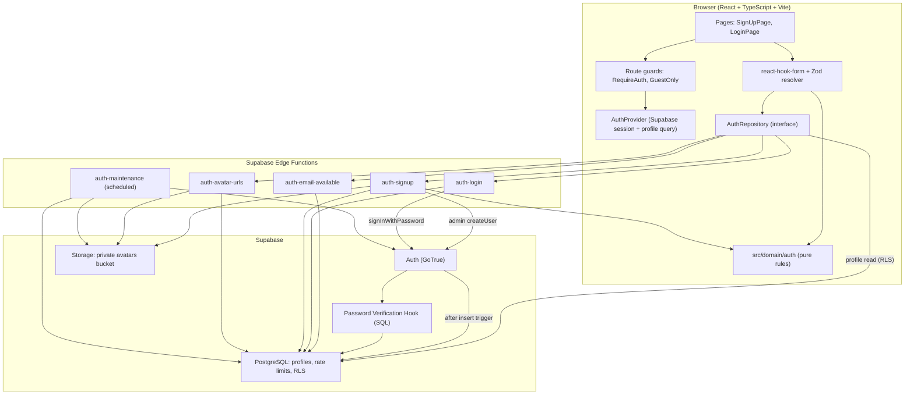
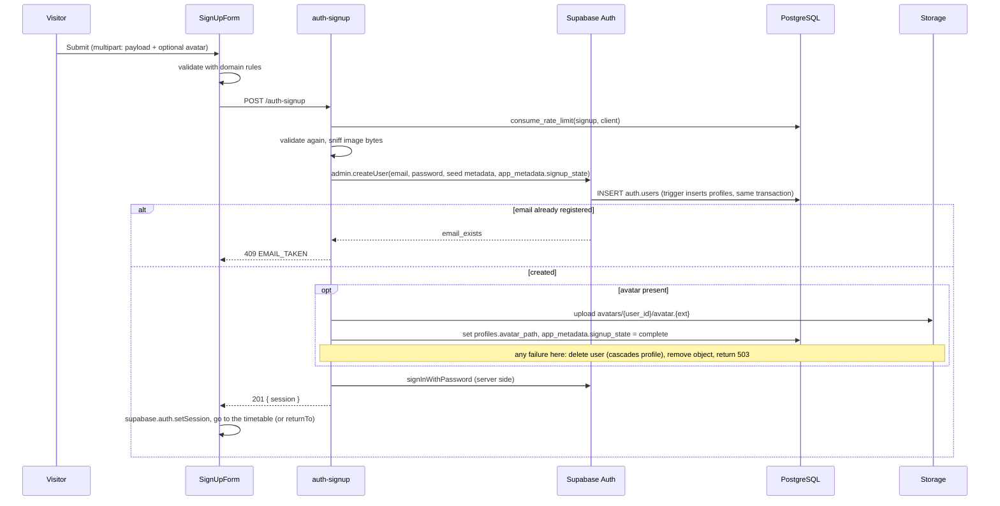
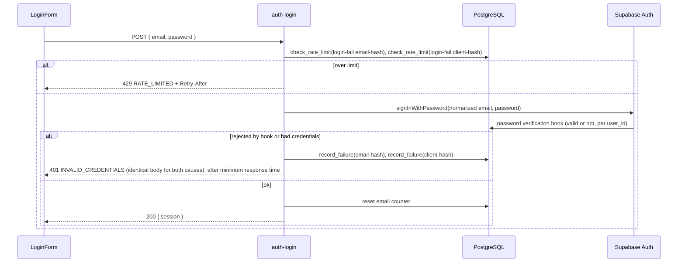
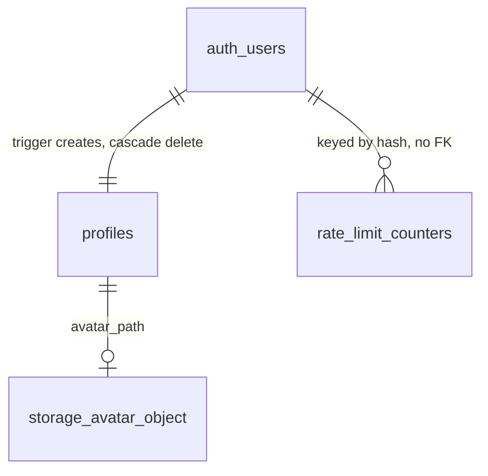

# Design: Authentication

Status: DRAFT v1, awaiting review. Based on `requirements.md` v1. `tasks.md` is not started. No implementation code exists or is written here.

## Overview

This feature lets a visitor sign up, sign in and sign out, and it owns the `profiles` table that other features read. It uses Supabase Auth for credentials and sessions, PostgreSQL for the profile, Supabase Storage for avatars and Edge Functions for the operations that need more than Supabase Auth offers (atomic sign-up with an image, email availability, login throttling).

### Inputs inspected and what they mean for the design

| Input | Finding | Consequence |
|---|---|---|
| `authentication/requirements.md` | R1 to R11. It refers to assumptions `A-1` to `A-10` and open questions `OQ-1` to `OQ-6`, but the file has **no section 6 or 7 and no Edge Cases or Out of Scope section** (its section 0 says they exist) | I could not read the official wording of `A-n` and `OQ-n`. Section "Assumptions and open questions" reconstructs each one from the inline references and states how this design resolves it. **Confirm the reconstruction, and add the missing sections to `requirements.md`** |
| `personal-weekly-timetable/design.md` | Expects `profiles(id, username, display_name)` (section 4.3), friend and participant results that show `display name and username` (R9.2, section 9.3), `auth.uid()` in policies, a JWT check in its Edge Function, and decision D-A (this spec owns `profiles`, no stub) | **Two conflicts**, see "Consistency with the personal-weekly-timetable design": this spec has `nickname` (non-unique) and no `username`, and the timetable's timezone fallback chain skips the profile's preferred timezone |
| `personal-weekly-timetable/tasks.md` | Tasks 5.3 and 5.11 are blocked on gate G-4 (this spec) | The profiles migration must be ordered before every timetable migration |
| Steering | `tech.md`: Supabase Auth, RLS with tests, Edge Functions, Zod and react-hook-form, IANA zones. `structure.md`: `src/domain`, `src/lib` for Zod schemas, `supabase/functions/<name>/deno.json`, HTTP mapping | Followed throughout |
| Source code, schema, Figma | None exist, or Figma is not readable here | Greenfield. UI layout values are `[F]` and unverified |

Conventions: `[F]` Figma value to confirm. **Provisional** a decision taken from a proposed default that you can change. `Rx.y` is a requirement. `D-n` is a design decision.

### Technical decisions

| ID | Decision | Alternatives considered | Why |
|---|---|---|---|
| D-1 | Supabase Auth (GoTrue) stores credentials, hashes passwords and issues sessions. No custom credential storage | Custom users table and JWT | Steering mandates it. Passwords never touch our tables (R3.7) |
| D-2 | **Public sign-up is disabled in Supabase Auth.** Accounts are created only by the `auth-signup` Edge Function through the admin API | Browser calls `supabase.auth.signUp` and then inserts a profile | The browser path cannot be atomic with an avatar upload, cannot enforce "2 of 4 character types" (GoTrue only offers all-of), and would let a client skip our validation (R1.2, R3.2, R3.6, R4.4) |
| D-3 | **The profile row is created by a trigger on `auth.users`**, in the same transaction as the user row | Edge Function inserts the profile after `createUser` | A trigger cannot be skipped and makes "account and profile, or neither" a database guarantee (R1.2). If the trigger raises, the user insert rolls back |
| D-4 | **Login runs through the `auth-login` Edge Function, and a Password Verification Hook enforces the per-account lockout** | Only the hook; only the Edge Function; browser calls Supabase Auth directly | The Edge Function throttles by email string and by client, including unknown emails (the hook only sees existing `user_id`s). The hook closes the bypass where an attacker calls the Supabase Auth token endpoint directly. Both share one counter table (D-8). Needs a spike (R-2) |
| D-5 | **One multipart request creates the account and its avatar.** The image is uploaded after the user row exists, and a compensating delete plus a scheduled reaper guarantee no orphans | Two requests (create, then upload); upload to a staging path first | A two-step flow leaves an account without the image the user chose, and profile editing is out of scope (OQ-6), so the user could never add it. Staging uploads add a second orphan class |
| D-6 | **Avatars live in a private bucket. Only the service role writes. Other users get short-lived signed URLs from the `auth-avatar-urls` Edge Function** | Public bucket; storage RLS allowing authenticated reads | A public bucket is listable by URL guessing and violates R5.6. Storage RLS cannot hide the listing API from users who can create signed URLs |
| D-7 | **The profile contract is one SQL function, `get_public_profiles(ids)`, returning `id`, `nickname`, `avatar_path`** and nothing else. `profiles` itself is readable only by its owner | A view; RLS letting friends read rows | RLS cannot restrict columns, so a table policy would expose phone and timezone. A security-definer function returns exactly the contract columns (R9.2). Other specs call it from their own security-definer functions |
| D-8 | **Rate limits are fixed-window counters in a private PostgreSQL table, updated atomically with one upsert** | In-memory counters in the Edge Function; Redis; platform limits only | Edge Function instances do not share memory. Platform limits do not know our buckets (email, client). No new infrastructure |
| D-9 | **Validation rules are pure functions in `src/domain/auth`**, composed into Zod schemas in `src/lib/schemas/auth.ts`, used by the browser and by every Edge Function through an import map | Duplicated rules | Single source of truth (same decision as timetable D-6, same bundling risk R-1) |
| D-10 | **Phone parsing uses `libphonenumber-js` with its full (`max`) metadata, in the browser and on the server** | Hand-written regex per country; `min` metadata in the browser | Numbering rules per country are not hand-written work (R7.3). Using the same metadata on both sides avoids a number that passes in the form and fails on the server. Cost: about 145 kB, so the phone field is lazy-loaded |
| D-11 | **Email verification is not required at sign-up (OQ-1)**; the user is signed in at once (R1.3) | Require a confirmation link | Requirements mark it out of scope. Consequence in R-5 |
| D-12 | **The session is the Supabase Auth session in `localStorage`** with refresh-token rotation | Cookie session through a server | There is no server of ours in front of the SPA (Vercel static). Trade-off in R-6 |
| D-13 | **Rate-limit keys are SHA-256 hashes** of purpose, a secret salt and the value (email or client address). Raw emails and addresses are not stored in counters | Plain keys | Counter rows then carry no personal data |

New runtime dependencies proposed (steering lists none for auth, so **these need your approval**): `libphonenumber-js`, `@hookform/resolvers` (connects Zod to react-hook-form). Dev dependency: `fast-check` (property tests; steering names Vitest only). `luxon`, `zod`, `react-hook-form` and `@tanstack/react-query` are already in the steering list.

## Assumptions and open questions

The requirements file refers to these identifiers without defining them (see the note above). The "Meaning" column is **my reading of the inline reference**. The last column is how this design resolves it.

| ID | Meaning (from `requirements.md`) | Resolution in this design |
|---|---|---|
| A-1 | Availability check is rate limited and never reveals availability when limited (R2.6) | 20 checks per minute per client. A limited reply has no `available` field. Section "Email availability" |
| A-2 | Password maximum is 72 bytes (R3.3) | Counted in UTF-8 bytes in the domain function, matching bcrypt's limit. Never truncated |
| A-3 | Password may not equal the email (R3.8) | Compared with the normalized email, case-insensitively |
| A-4 | Phone numbers are stored, not verified (R7.7, section 1.3) | No `verified` column exists |
| A-5 | Nickname is 2 to 30 characters, letters of any language, numbers, `_ - .`, single spaces (R4.1, R4.2) | Domain validator plus database structural checks. The letter-class check is not expressible in a PostgreSQL `CHECK` (see section "profiles") |
| A-6 | Nicknames are not unique (R4.3) | No unique index. Consequence for friend search in the cross-spec section |
| A-7 | Avatar: JPEG, PNG or WebP, up to 5 MB (R5.2) | Enforced by content sniffing on the server and by bucket limits |
| A-8 | Country code selector defaults from the timezone, else none (R7.2) | Static zone-to-country table generated from tzdata |
| A-9 | Phone numbers are not unique (R7.6) | No unique index |
| A-10 | Login lockout is 5 failures per 15 minutes per email or per client (R8.4) | Implemented as configuration constants. Shared-network risk in R-4 |
| OQ-1 | Email verification (section 1.3) | Not required, D-11. **Open for a decision before launch**, see R-5 |
| OQ-2 | Email and phone are never returned to other users (section 1.4, R9.2) | Yes. Enforced by D-7 |
| OQ-3 | Password reset and change are out of scope (section 1.3) | Out of scope. Not designed. **Gap**: a user who forgets a password has no recovery in the MVP, see R-7 |
| OQ-4 | Session lifetime (R9.1) | **Provisional**: access token 1 hour, refresh token rotated, no absolute timeout. The session lasts until sign-out or revocation |
| OQ-5 | Not referenced anywhere in the file | Unknown. **Please supply it** |
| OQ-6 | Profile editing and account deletion go to a later Profile spec (section 1.3) | Out of scope. The schema supports them (cascade delete, own-row update grant, section "RLS") |

## Architecture

### Layers



Rules:
- Components receive an `AuthRepository` through React context, so tests and the timetable's mock phases can replace it. No component imports `supabase-js` directly.
- `src/domain/auth` has no React, DOM, Supabase or Node imports. It runs in the browser, in Vitest and in Deno.
- Session data lives in the Supabase client. The profile is server data and lives in TanStack Query. Form state lives in react-hook-form. Zustand is not needed for this feature.
- The service-role key exists only in Edge Function environments (R11.2).

### Folder layout (follows `structure.md`)

```
src/
  domain/auth/            email.ts, password.ts, nickname.ts, phone.ts, time-zone.ts, avatar-sniff.ts,
                          return-path.ts, tz-country.ts (generated), issue-codes.ts, *.test.ts
  lib/schemas/auth.ts     Zod schemas composed from the domain rules
  lib/supabase/           client (shared with other features)
  features/auth/
    components/           SignUpForm, LoginForm, EmailField, PasswordField, PasswordRules, NicknameField,
                          AvatarPicker, PhoneField, ErrorSummary, UserMenu, SessionExpiredDialog, Avatar
    hooks/                useSession, useProfile, useEmailAvailability, usePublicProfiles
    data/                 AuthRepository, supabase/, mock/
    routes/               RequireAuth, GuestOnly
    messages/             English message catalogue (issue code to text)
supabase/
  migrations/             <ts>_auth_profiles.sql, <ts>_auth_rate_limit.sql, <ts>_auth_hook.sql, <ts>_auth_storage.sql
  functions/_shared/      http.ts (CORS, error mapping, client address), env.ts, supabase-admin.ts
  functions/auth-signup/  index.ts, deno.json
  functions/auth-login/   index.ts, deno.json
  functions/auth-email-available/  index.ts, deno.json
  functions/auth-avatar-urls/      index.ts, deno.json
  functions/auth-maintenance/      index.ts, deno.json
  config.toml             Auth settings (section "Supabase Auth configuration")
tests/e2e/auth/
```

`functions/_shared` is the Supabase convention for code shared by several functions. Each function still has its own `deno.json` import map, as steering requires. The timetable's Edge Function may import `_shared/http.ts` so both specs return one error shape.

### Sign-up flow



The browser and the function both run `validateSignUp`. If validation passes in the browser and fails on the server, the server issue list is shown next to the fields.

If the final sign-in call fails after the account exists, the function returns `201` with `session: null`. The form then sends the user to the login page with a notice. The account is not rolled back, because it is valid.

**Crash safety.** If the function dies between creating the user and finishing the avatar, the user has `app_metadata.signup_state = 'pending'` (set only when an avatar was sent; `app_metadata` can be written only by the admin API, unlike `user_metadata`). `auth-maintenance` deletes pending users older than 15 minutes, which is longer than the function timeout, and removes their objects. A user who logs in during that window and then is deleted is not a realistic case: the password is known only to the person whose request is in flight.

### Login flow



A request that is itself rejected for throttling is not counted again. This keeps the block from growing, so an attacker cannot hold a victim out longer than one window by sending more traffic.

The response time floor (500 ms, a constant) applies to every `INVALID_CREDENTIALS` answer, so an unknown email (which skips the password hash comparison) is not visibly faster (R8.3).

### Email availability

`auth-email-available` takes `{ email }`, checks the `signup-availability` bucket (20 per minute per client, A-1), then asks `private.auth_email_exists(email)`, a function executable only by the service role. It returns `{ available: boolean }`. When limited it returns `429` with no `available` field. A failure returns `503` and the form shows "could not check" and still lets the user submit, because the submit-time check decides (R2.4, R2.7).

This endpoint lets a caller test whether an email is registered. Requirement R2.3 asks for that, and the sign-up conflict reveals it anyway. The limit slows enumeration but does not stop a distributed one. Accepted, see R-3.

### Supabase Auth configuration (`supabase/config.toml`)

| Setting | Value | Reason |
|---|---|---|
| Public sign-up | disabled (admin `createUser` still works) | D-2 |
| Email confirmations | off | D-11 |
| Minimum password length | 10 | Backstop for R3.1. The "2 of 4 types" rule is ours |
| Access token lifetime | 3600 s | OQ-4 |
| Refresh token rotation | on, reuse interval 10 s | Limits stolen refresh tokens |
| Password Verification Hook | `public.hook_password_verification` | D-4 |
| Built-in rate limits | defaults, not relied on for R8.4 | They are per client only |

## Components and Interfaces

### Domain functions (`src/domain/auth`)

All are pure. Issue codes are the only error vocabulary and are mapped to text in `messages/`.

```ts
type Issue = { code: IssueCode; path: string };            // path: 'email' | 'password' | 'nickname' | 'timeZone' | 'phone' | 'avatar'

normalizeEmail(raw: string): string                        // trim + lowercase. R2.2, R8.5
validateEmail(raw: string): Issue[]                        // format, <= 254 chars
evaluatePassword(pw: string, email: string): PasswordReport // { minLength, typeCount, typesOk, withinBytes, notEmail, byteLength }
validatePassword(pw: string, email: string): Issue[]       // derived only from evaluatePassword
normalizeNickname(raw: string): string                     // trim, NFC
validateNickname(raw: string): Issue[]
isValidTimeZone(name: string): boolean                     // canonical IANA names only
normalizePhone(input: { country: string | null; national: string }): Result<{ e164: string } | { none: true }, Issue[]>
sniffImage(bytes: Uint8Array): { ok: true; mime: 'image/jpeg'|'image/png'|'image/webp'; ext: string } | { ok: false; code: IssueCode }
sanitizeReturnPath(raw: string | null | undefined): string | null
defaultCountryForZone(zone: string): string | null
```

Rules in detail:

- **Password** (R3): length is counted in characters (code points) for the minimum and in UTF-8 bytes for the maximum. Character types are uppercase letters, lowercase letters, digits, and "symbols" (anything else that is not whitespace-only). At least 2 types are needed. The `typeCount` field supports the live feedback text (R3.4). `validatePassword` calls `evaluatePassword`, so the two cannot disagree.
- **Nickname** (R4): after trim and NFC normalization, 2 to 30 characters (code points); each character must be a Unicode letter or number, or one of `_ - .`, or a single space that is neither first, last nor next to another space. Control characters are rejected.
- **Timezone** (R6.4): `isValidTimeZone` accepts a name only if it matches `^[A-Za-z_]+(/[A-Za-z0-9_+\-]+)*$`, is not prefixed `posix/` or `right/`, and Luxon's `IANAZone.isValidZone` accepts it, or it is `UTC`. Abbreviations such as `EST` or `PST8PDT` are rejected. The database trigger (below) is the authority; the domain function is a fast pre-check.
- **Return path** (R8.9): the output is `null`, or a string that starts with exactly one `/`, contains no `\`, no control characters and no scheme or authority when parsed against a dummy origin (the parsed origin must equal the dummy origin), is at most 512 characters, and is not `/login` or `/signup`.
- **Image sniffing** (R5.2): JPEG starts `FF D8 FF`, PNG starts with the 8-byte PNG signature, WebP is `RIFF....WEBP`. Anything else, including SVG and GIF, is rejected. Size over 5 MiB is rejected. The claimed file name and MIME type are ignored.
- **Phone** (R7): input is an ISO country code and the national number text. Both empty gives `{ none: true }`. Exactly one empty gives `PHONE_INCOMPLETE`. Otherwise `parsePhoneNumberFromString(national, country)` must be valid for that country, and the result is formatted as E.164. Spaces, hyphens, parentheses and a leading trunk zero are handled by the library.
- **Country default** (R7.2, A-8): a static map `zone -> ISO country` generated by a script from tzdata `zone1970.tab`. Zones with several countries map to the first listed country. Unmapped zones return `null`.

### Zod schemas (`src/lib/schemas/auth.ts`)

`signUpSchema`, `loginSchema`, `emailAvailabilitySchema`, `avatarUrlsSchema` wrap the domain functions with `superRefine` so Zod reports the same issue codes. Strings are trimmed once, at parse time. Unknown keys are rejected. `avatarUrlsSchema` accepts 1 to 50 UUIDs.

### Repository (`features/auth/data`)

```ts
interface AuthRepository {
  checkEmailAvailable(email: string, signal?: AbortSignal): Promise<Result<{ available: boolean }>>;
  signUp(input: SignUpInput, avatar: File | null): Promise<Result<{ signedIn: boolean }>>;
  logIn(email: string, password: string): Promise<Result<void>>;
  logOut(): Promise<Result<void>>;
  getMyProfile(): Promise<Result<MyProfile>>;                              // owner row
  getPublicProfiles(ids: string[]): Promise<Result<PublicProfile[]>>;      // contract, with signed avatar URLs
}
interface MyProfile { id: string; nickname: string; preferredTimeZone: string; phoneE164: string | null; avatarUrl: string | null }
interface PublicProfile { id: string; nickname: string; avatarUrl: string | null }
```

`Result<T>` is `{ ok: true, value } | { ok: false, error: { code; issues? ; retryAfterSeconds? } }`, the same shape as the timetable repository. A `MockAuthRepository` serves Storybook-style development and the timetable's mock phases.

### Wire API

| Endpoint | Method | Auth | Request | Success | Errors |
|---|---|---|---|---|---|
| `auth-signup` | POST multipart: `payload` (JSON), `avatar` (optional file) | none | `{ email, password, nickname, timeZone, phone?: { country, national } }` | `201 { session \| null }` | 400 `VALIDATION` with issues, 409 `EMAIL_TAKEN`, 429, 503 |
| `auth-login` | POST JSON | none | `{ email, password }` | `200 { session }` | 400, 401 `INVALID_CREDENTIALS`, 429, 503 |
| `auth-email-available` | POST JSON | none | `{ email }` | `200 { available }` | 400, 429, 503 |
| `auth-avatar-urls` | POST JSON | JWT | `{ userIds: uuid[1..50] }` | `200 { urls: { [userId]: string \| null } }` | 400, 401, 503 |
| `auth-maintenance` | POST | shared secret header (scheduler only) | none | `200 { removed… }` | 401 |
| `get_public_profiles(ids)` | RPC | JWT | `uuid[]` up to 50 | rows `(id, nickname, avatar_path)` | 401 without JWT |
| Own profile | `select` on `profiles` | JWT, RLS | none | own row | none |

Every function answers `OPTIONS` and sends CORS headers for the origins in `ALLOWED_ORIGINS` only. Request bodies over 6 MB are rejected. Error bodies are `{ error: { code, message, issues? } }`, with no SQL text and no stack traces. `Retry-After` is set on every 429.

### UI components (`features/auth/components`)

Figma frames were not readable, so every layout statement is `[F]` and unverified.

| Component | Responsibility | Notes |
|---|---|---|
| `SignUpForm` | The form for R1, owns react-hook-form state | Keeps all values except the password after a failure (R1.5). Disables submit while pending (R1.6). One `requestId`-free submit |
| `EmailField` | Email input with blur availability check | `useEmailAvailability`: cancels the previous request, caches by normalized email, states `idle`, `checking`, `taken`, `free`, `unknown`, `limited`. `unknown` and `limited` never claim an answer (R2.6, R2.7) |
| `PasswordField` and `PasswordRules` | Masked input, show/hide button, live rule list | Each rule shows a text status ("Met" / "Not met") and an icon, so color is not the only signal (R3.4, R10.2). The toggle is a real button |
| `NicknameField` | Nickname input with counter | |
| `AvatarPicker` | Choose, preview, remove | Checks type and size in the browser for fast feedback, then re-encodes to WebP with a longest side of 512 px on a canvas, which also strips EXIF metadata. The server sniffs the bytes it receives regardless. Remove is a button (R5.4) |
| `TimezoneCombobox` | Searchable IANA list with current UTC offset | The offset is computed with Luxon at render time and labeled "current offset", because it changes with DST. **Shared with the timetable's `TimezoneSelect`**: both specs need the same control, so it should live in `src/components/` and be built once. Coordinate in Task planning |
| `PhoneField` | Country selector (searchable by name or code, shows `+82`) and national number | Lazy-loaded. Default country from `defaultCountryForZone` until the user picks one. Country names come from `Intl.DisplayNames` |
| `ErrorSummary` | Lists field errors with links to fields | Receives focus on a failed submit when the first invalid field is not visible (R10.3) |
| `LoginForm` | Email, password, submit | Same error text for any credential failure. Shows a countdown text for 429 using `Retry-After` |
| `AuthProvider` | Subscribes to `onAuthStateChange`, exposes `status: 'loading' \| 'signedIn' \| 'signedOut'` | On sign-out it clears the TanStack Query cache and the timetable stores, so no other user's data remains (R9.4) |
| `RequireAuth` / `GuestOnly` | Route guards | `RequireAuth` stores a sanitized `returnTo` (R8.9). `GuestOnly` redirects signed-in users (R8.7) |
| `SessionExpiredDialog` | Shown when the session ends while the app is open | The page stays mounted underneath, so unsaved form input in an open timetable editor survives. Signing in again as the **same** user closes the dialog. A **different** user causes a full state reset and navigation to the timetable (R9.4) |
| `UserMenu` | Shows `Avatar` and nickname, Sign out | Fits the timetable's `AppHeader.userMenu` slot |
| `Avatar` | Image or initial placeholder | `alt` is the nickname for the image. The initial placeholder is `aria-hidden` next to the nickname text (R5.1, R5.7) |

Accessibility (R10): every field has a visible label, `aria-describedby` links errors, errors are text with an icon, status changes use a polite live region, tab order follows visual order, focus styles come from the design tokens. Autocomplete attributes: email `username` on login and `email` on sign-up, `new-password`, `current-password`, `tel-national`, `nickname`. Layout is one column on mobile with no horizontal scroll (R10.4, `[F]`). Full WCAG compliance still needs manual assistive-technology testing.

### Consistency with the personal-weekly-timetable design

| # | Item | This spec | Timetable design says | Proposed resolution (needs your decision) |
|---|---|---|---|---|
| X-1 | Name fields | `profiles.nickname`, not unique (A-6). **No `username`** | `profiles(id, username, display_name)`; friend search, `UserSummary` and participant lists show `display name and username` (R9.2, sections 4.3 and 9.3, task 1.x mock, task 5.3) | Treat the timetable's `display_name` as this spec's `nickname`. Drop `username` from the timetable until the Friend Management spec decides how to tell two users with one nickname apart (it may add a unique handle). Edits needed in timetable requirements R9.1/R9.2, design 4.3, 5.1, 9.3 and tasks 1.x, 5.3, 7.x |
| X-2 | Initial display timezone | Stored as `profiles.preferred_time_zone`, owner-only (R6.5, R6.6) | Effective timezone is saved preference, else browser, else UTC (R14.17) and `timetable_preferences.time_zone` is null by default | Timetable fallback becomes: saved preference, else **profile preferred timezone**, else browser, else UTC. The timetable reads it from `getMyProfile()`. The sign-up does not write `timetable_preferences`, because that table belongs to the timetable and would create a migration-order dependency |
| X-3 | Migration order | `<ts>_auth_profiles.sql` first | `timetable_preferences.user_id` references `profiles(id)` | Timetable migrations depend on this one. Task 5.3 becomes "depend on the auth migration", as D-A states |
| X-4 | JWT and `auth.uid()` | Standard Supabase Auth | Edge Function verifies the JWT, policies use `auth.uid()` | Compatible. No claims are added to the JWT |
| X-5 | Error shape and codes | `{ error: { code, message, issues? } }`, 400/401/403/404/409/429/503 | Same shape, `VALIDATION`, `FORBIDDEN`, `STALE_VERSION` ... | Compatible. Auth adds `EMAIL_TAKEN`, `INVALID_CREDENTIALS`, `RATE_LIMITED`. Timetable may import `_shared/http.ts` |
| X-6 | Participant names and avatars | `get_public_profiles` is the only way to read another user's profile | `get_event_participants` returns display name and username only | The timetable's SQL functions call `get_public_profiles` internally. Avatar URLs come from `auth-avatar-urls` |
| X-7 | Timezone validity | `profiles` trigger against `pg_timezone_names` | Same approach for `events.time_zone` (R-4 in that design) | Use the one SQL function `public.is_valid_time_zone(text)` for both. This spec defines it |
| X-8 | Timezone UI | `TimezoneCombobox` | `TimezoneSelect` | Build once, share (see components table) |
| X-9 | Default timezone detection | Browser value preselected at sign-up (R6.1) | `tech.md`: detected "at first sign-in", never silently overwrites a saved choice | Consistent. The profile value is the saved choice from the first moment |

I did not edit the timetable documents. X-1 and X-2 are changes to them that you need to approve.

## Data Models

Names are `snake_case`. All timestamps are `timestamptz` in UTC (steering). Helper functions live in the `private` schema, which is not exposed through the API. Every `SECURITY DEFINER` function sets `search_path` to empty and uses schema-qualified names.

### Entity relationships



### `profiles`

| Column | Type | Constraint |
|---|---|---|
| `id` | uuid PK | references `auth.users(id)` on delete cascade |
| `nickname` | text not null | `char_length` 2 to 30. Equals `btrim(nickname)`. Equals `normalize(nickname, NFC)`. No `'  '` (double space). No `[[:cntrl:]]` characters |
| `preferred_time_zone` | text not null | `before insert or update` trigger calls `public.is_valid_time_zone` |
| `phone_e164` | text null | `~ '^\+[1-9][0-9]{6,14}$'` |
| `avatar_path` | text null | `~ ('^' || id::text || '/avatar\.(jpg\|png\|webp)$')` so a user can only point at their own folder |
| `created_at`, `updated_at` | timestamptz | `updated_at` set by trigger |

- There is **no email column**. The email stays in `auth.users`, which is not exposed to the API (R7.8, R9.2).
- There is no `username` and no `verified` flag (A-4, X-1).
- The letter and number character class of A-5 cannot be written as a PostgreSQL `CHECK` (the regex engine has no Unicode property classes). The database enforces the structural rules above, and the domain validator in the Edge Function enforces the class. Direct own-row updates (below) could therefore store a nickname with unusual symbols. That is harmless to other users because nicknames are rendered as text, and the Profile spec will route edits through the same validation.
- `public.is_valid_time_zone(text)` is `stable`, checks the regex and prefix rules of the domain function, then looks the name up in `pg_timezone_names`, and also accepts `UTC`.

### Profile creation trigger

`private.handle_new_user()` runs `after insert on auth.users`. It reads `nickname`, `time_zone` and `phone_e164` from `raw_user_meta_data`, inserts the `profiles` row, and then removes those three keys from the user's metadata. Removing them prevents the phone number from being copied into every JWT, because Supabase Auth places `user_metadata` in the token. If the insert fails any constraint, the exception aborts the whole user insert, so no account without a profile exists (R1.2).

### `private.rate_limit_counters`

| Column | Type | Constraint |
|---|---|---|
| `bucket` | text | SHA-256 hex of `purpose:value` with the secret salt (D-13) |
| `window_start` | timestamptz | start of the fixed window, half-open `[window_start, window_start + window)` |
| `count` | integer | not null |
| PK | | `(bucket, window_start)` |

Functions, all executable only by `service_role` and `supabase_auth_admin`:
- `private.rate_limit_hit(bucket, max, window)` upserts the counter for the current window (`insert ... on conflict do update set count = count + 1 returning count`) and returns `(allowed, retry_after_seconds)`. Atomic, so concurrent requests cannot both pass on the last slot.
- `private.rate_limit_check(bucket, max, window)` reads without incrementing. Login uses `check` before the attempt and `hit` only after a failure.
- `private.rate_limit_reset(bucket)` clears an email's login counter after a success.

| Purpose | Key | Limit | Window | On limiter database error |
|---|---|---|---|---|
| `availability` | client | 20 | 1 min | 503 (R2.7) |
| `signup` | client | 10 | 1 hour | 503 |
| `login-fail-email` | normalized email | 5 | 15 min | 503 (fail closed) |
| `login-fail-client` | client | 5 | 15 min | 503 (fail closed) |
| `login-fail-user` | `user_id` (hook) | 5 | 15 min | the hook returns `continue`, because Edge counters still apply |

"Client" is the first address in `x-forwarded-for` set by the Supabase gateway (to verify in the spike, R-2). If it is missing (local development) the key is `unknown`. Limits are constants in `_shared/env.ts`, so they can change without code in the callers (A-10).

A fixed window allows up to twice the limit across a window boundary. This is accepted; a sliding window is not worth the extra storage here.

### Password Verification Hook

`public.hook_password_verification(event jsonb) returns jsonb` is granted to `supabase_auth_admin` only. It receives `user_id` and `valid`.
1. If `login-fail-user` for that user is already over the limit, return `{ decision: 'reject', message: 'try again later' }` **without recording**, even when `valid` is true.
2. If `valid` is false, `rate_limit_hit` for the user and return `continue`.
3. If `valid` is true, reset the user's counter and return `continue`.

This blocks direct calls to the Supabase Auth token endpoint for existing accounts. Unknown emails and the client limit are enforced only by `auth-login` and by the Supabase Auth built-in per-client limits, because the hook never sees them. This gap is documented in R-2.

Per-account lockout lets someone else keep an account locked by repeating five failures every window. Requirement R8.4 asks for this lockout, so the design accepts it and records the risk (R-4).

### Storage

Bucket `avatars`: private, `file_size_limit` 5 MiB, `allowed_mime_types` image/jpeg, image/png, image/webp. **No policies on `storage.objects` for `anon` or `authenticated`**, so direct reads, writes and listing are denied. Objects are named `{user_id}/avatar.{ext}`; the extension comes from `sniffImage`, never from the file name, and the object `contentType` is set from the sniffed type. Clients get access only through signed URLs of 1 hour from `auth-avatar-urls`.

`auth-avatar-urls` verifies the JWT, reads `avatar_path` for the requested ids through `get_public_profiles` (so the contract stays the single source), and signs with the service role. It never accepts a path from the client. Unknown ids and users without an avatar return `null`, with no error difference between them. Clients cache URLs for 30 minutes.

### Row Level Security and privileges

`profiles` has RLS enabled. `anon` and `authenticated` start with no privileges, then:

| Operation | Role | Rule |
|---|---|---|
| select | authenticated | `id = auth.uid()`, columns `id, nickname, preferred_time_zone, phone_e164, avatar_path, created_at` |
| update | authenticated | `id = auth.uid()` both `using` and `with check`, column grant only on `nickname, preferred_time_zone, phone_e164, avatar_path` (R9.7). No UI uses it yet (OQ-6) |
| insert, delete | authenticated | none. Insert happens in the trigger, delete by cascade |
| anything | anon | none |
| `get_public_profiles(uuid[])` | authenticated | `security definer`, returns `(id, nickname, avatar_path)` for up to 50 ids, error beyond that. Callable by `service_role` as well |

`get_public_profiles` returns rows for any requested id, to any signed-in caller. Ids are random UUIDs, so this does not allow browsing. Other specs decide who they ask about. If a rule such as "friends and teammates only" is wanted, it goes into this one function body.

`private.rate_limit_counters`, the `private` functions and `auth.users` are not reachable by `anon` or `authenticated`. RLS is enabled on the counters table with no policies, as a second barrier (steering: RLS on every table).

### Maintenance job (`auth-maintenance`)

Scheduled hourly by `pg_cron` calling the function through `pg_net` with a shared secret header. Each run is idempotent:
1. Delete users with `app_metadata.signup_state = 'pending'` older than 15 minutes (cascades the profile).
2. List objects in `avatars`; remove those whose folder is not a `profiles.id`, or whose path differs from that profile's `avatar_path`, and that are older than 1 hour.
3. Delete counter rows whose window ended more than 1 day ago.

Objects are removed through the Storage API, not by SQL on `storage.objects`, because deleting rows alone leaves the files.

## Correctness Properties

*A property is a characteristic or behavior that should hold true across all valid executions of a system-essentially, a formal statement about what the system should do. Properties serve as the bridge between human-readable specifications and machine-verifiable correctness guarantees.*

These properties cover the pure functions in `src/domain/auth` and the pure parts of the Edge Functions. Database, Storage and Supabase Auth behavior is tested with integration tests (Testing Strategy), not property tests.

**Reflection.** Prework criteria 1.4 (whole-form validity) and 3.1, 3.2, 3.3, 3.8 (password rules) are covered by the field-level properties and the password model property, so no separate whole-form property is kept. 3.4 (live feedback) and 3.1 to 3.3 would be two properties on the same function pair, so they are combined into Property 3 and Property 4 only where they check different things (reference model versus agreement). 2.1 and 2.2 stay separate: one is acceptance, the other is invariance under case and spacing. 6.1 and 6.2 fold into Property 8. 4.1, 4.2 and 4.4 are one nickname property.

### Property 1: Email normalization is idempotent and ignores case and padding

For any email string `e`, any variation `e'` made by changing letter case and adding leading or trailing whitespace, `normalizeEmail(e') = normalizeEmail(e)`, and `normalizeEmail(normalizeEmail(e)) = normalizeEmail(e)`.

**Validates: Requirements 2.2, 8.5**

### Property 2: Email validation accepts well-formed addresses and enforces the length limit

For any string longer than 254 characters, `validateEmail` returns an issue. For any generated well-formed address of at most 254 characters, `validateEmail` returns no issues.

**Validates: Requirements 2.1**

### Property 3: Password validity matches the reference rule

For any password `p` and email `e`, `validatePassword(p, e)` returns no issues if and only if the number of characters of `p` is at least 10, the UTF-8 byte length of `p` is at most 72, `p` contains characters of at least 2 of the 4 types, and `p` differs from `normalizeEmail(e)` compared case-insensitively. The function never alters `p`.

**Validates: Requirements 3.1, 3.2, 3.3, 3.6, 3.8**

### Property 4: Live password feedback agrees with validation

For any password `p` and email `e`, every flag in `evaluatePassword(p, e)` is satisfied if and only if `validatePassword(p, e)` returns no issues.

**Validates: Requirements 3.4**

### Property 5: Nickname validity and normalization

For any string `n`, `normalizeNickname` is idempotent, and `validateNickname(n)` returns no issues if and only if the normalized value has 2 to 30 characters, contains only letters, numbers, `_`, `-`, `.` and single interior spaces, and contains no control characters.

**Validates: Requirements 4.1, 4.2, 4.4**

### Property 6: Phone numbers normalize to a stable E.164 value

For any country and any valid national number for it, written with any mix of spaces, hyphens, parentheses and an optional leading trunk zero, `normalizePhone` returns the same E.164 string, the string matches `^\+[1-9][0-9]{6,14}$`, and parsing that string again yields the same country calling code and national number.

**Validates: Requirements 7.1, 7.3**

### Property 7: Partial phone input is rejected and empty input means no phone

For any country value and national number text, if exactly one of them is empty after trimming, `normalizePhone` returns `PHONE_INCOMPLETE`. If both are empty it returns `{ none: true }`.

**Validates: Requirements 7.4, 7.5**

### Property 8: Timezone validation accepts only canonical IANA names

For any name in the reference list of canonical IANA identifiers, `isValidTimeZone` returns true. For any name produced by changing its case, adding whitespace, adding a `posix/` prefix, or replacing it with an abbreviation or arbitrary text, `isValidTimeZone` returns false.

**Validates: Requirements 6.1, 6.2, 6.4**

### Property 9: Return paths never leave the application

For any string `s`, including generated open-redirect forms (`//host`, `/\host`, `https://host`, `javascript:`, encoded variants, control characters), `sanitizeReturnPath(s)` is `null` or a string that starts with a single `/`, parses against the application origin to that same origin, and is not the login or sign-up path.

**Validates: Requirements 8.9**

### Property 10: Image acceptance depends only on content and size

For any byte array and any claimed file name and MIME type, `sniffImage` accepts it if and only if its leading bytes match JPEG, PNG or WebP and its length is at most 5 MiB. The claimed name and type do not change the result.

**Validates: Requirements 5.2**

### Property 11: The public profile contract exposes only id, nickname and avatar path

For any profile row with any nickname, phone, timezone and avatar values, each row returned by `get_public_profiles` for its id has exactly the keys `id`, `nickname` and `avatar_path`, and no returned value equals the profile's phone number or timezone. This runs against local PostgreSQL with generated rows (database-backed property, 100 iterations on a small fixture).

**Validates: Requirements 9.2, 7.8, 6.6**

## Error Handling

HTTP mapping follows `structure.md` and R11.3. Error codes are the contract; messages are English text from the catalogue.

| Situation | HTTP | `code` | Notes |
|---|---|---|---|
| Invalid or missing field, bad image, malformed body | 400 | `VALIDATION` | `issues[]` with `code` and `path`. Password text is never echoed |
| Missing or invalid token on a protected endpoint or RPC | 401 | `UNAUTHENTICATED` | No data (R9.5) |
| Wrong password or unknown email | 401 | `INVALID_CREDENTIALS` | One identical body for both (R8.2) |
| Authenticated but not allowed | 403 | `FORBIDDEN` | Maintenance with a bad secret returns 401 instead, so scanners learn nothing |
| Email already registered | 409 | `EMAIL_TAKEN` | At sign-up. The form offers a "Sign in" link |
| Rate limit or lockout | 429 | `RATE_LIMITED` | `Retry-After` header and `retryAfterSeconds`. Availability replies carry no `available` |
| Payload larger than the platform allows | 413 | (platform) | Not in R11.3. The browser checks the size first, so users normally see `AVATAR_TOO_LARGE` |
| Dependency down (Auth, database, Storage) | 503 | `UNAVAILABLE` | Retryable. Nothing is partially created: failures after `createUser` run the compensation |
| Unexpected error | 500 | `INTERNAL` | Generic text. Details only in server logs, with no passwords, emails or tokens |

Issue codes (`IssueCode`): `EMAIL_REQUIRED`, `EMAIL_INVALID`, `EMAIL_TOO_LONG`, `PASSWORD_REQUIRED`, `PASSWORD_TOO_SHORT`, `PASSWORD_TOO_LONG`, `PASSWORD_TOO_WEAK`, `PASSWORD_EQUALS_EMAIL`, `NICKNAME_REQUIRED`, `NICKNAME_LENGTH`, `NICKNAME_CHARS`, `NICKNAME_SPACING`, `TIMEZONE_REQUIRED`, `TIMEZONE_INVALID`, `PHONE_INCOMPLETE`, `PHONE_INVALID`, `AVATAR_TYPE`, `AVATAR_TOO_LARGE`.

Client behavior:
- Sign-up failure keeps every value except the password, re-enables submit and moves focus to the first invalid field or the error summary (R1.5, R10.3).
- A `503` or network failure during sign-up shows a retry message. Because the server compensates, a retry cannot find a half-created account. If the first attempt did succeed but the response was lost, the retry gets `EMAIL_TAKEN`, and the form's "Sign in" link recovers (this is the idempotency path for R1.7: uniqueness guarantees one account, so no request-id table is kept).
- A `429` shows the wait time from `Retry-After` and disables submit until it elapses.
- Session loss while the app is open shows `SessionExpiredDialog` (R9.4).
- Logs contain error codes, function names and request ids only. Never passwords, emails, phone numbers, tokens or nicknames.

## Testing Strategy

Every acceptance criterion maps to at least one automated test (steering). Prework classification: pure rules use property tests, flows and database behavior use example and integration tests. Property-based testing does not apply to UI rendering, Storage, GoTrue behavior or rate-limit counters, so those use example and integration tests.

### Property-based tests

- Library: `fast-check` with Vitest. Not implemented by hand.
- Each of Properties 1 to 10 is one test with at least 100 iterations (`numRuns: 100` or more). Property 11 runs against local PostgreSQL with at least 100 generated rows.
- Each test carries a comment tag in the form `Feature: authentication, Property N: <property text>`.
- Generators: Unicode strings including multi-byte and combining characters (for the 72-byte and NFC rules), padded and mixed-case emails, the list from `Intl.supportedValuesOf('timeZone')` plus tzdata canonical names as the timezone reference, numbers produced from `libphonenumber-js` example numbers per country with random separators, and open-redirect corpora for Property 9.
- Property 8 also needs a database test that `public.is_valid_time_zone` and the domain function agree on the reference list. Names they disagree on go to an explicit allow or deny list in the test (risk R-8).

### Unit and component tests (Vitest, React Testing Library)

Table-driven: HTTP error mapper (R11.3), `defaultCountryForZone` examples (`Asia/Seoul` gives `KR`, an unmapped zone gives none), message catalogue covers every issue code. Components: sign-up form fields, optional marks, values kept after failure except password, submit disabled while pending, password rules show text status, show/hide by keyboard, availability states (`free`, `taken`, `unknown`, `limited`) never claim an answer on error, avatar preview and remove, placeholder initial and alt text, login form identical message, guards redirect (`GuestOnly`, `RequireAuth` with a sanitized return target), sign-out clears caches.

### Database and Edge Function tests (local Supabase, real Postgres)

| Area | Cases |
|---|---|
| RLS matrix | owner, other signed-in user, anonymous and service role against `profiles` select and update, `private` functions, counters, storage listing and direct read. Another user cannot read phone, timezone or email. Update of another user's row changes nothing. A catalog query asserts `relrowsecurity` on every table of this spec (R9.6) |
| Contract | `get_public_profiles` shape, 51 ids rejected, anonymous gets 401, unknown ids return no rows |
| Constraints | Nickname structure, `phone_e164` pattern, `avatar_path` must be the owner's folder, invalid timezone rejected, two users with equal nickname or phone succeed |
| Atomic sign-up | Trigger forced to fail: no `auth.users` row. Avatar upload forced to fail: user deleted, no object. Profile update after upload forced to fail: same. Function killed after `createUser`: maintenance removes the pending user and object |
| Concurrency | N parallel sign-ups with one email and case variants give exactly one user and N-1 `409`. Parallel hits on one rate-limit bucket never exceed the limit (the counter upsert is atomic) |
| Rate limits | Availability: 21st call in a minute gives `429`, with `Retry-After` and no `available`. Sign-up limit. Login: 5 failures then the 6th is blocked even with the right password, for an unknown email too, and the direct token endpoint is blocked for a locked existing account (hook). Rejected-for-throttling requests do not extend the block. Window boundary: a hit at `window_start + window` counts in the next window (half-open) |
| Login | Unknown email and wrong password give deep-equal bodies and both take at least the floor. Email with padding and capitals logs in. Success resets the email counter |
| Secrets | A sentinel password never appears in function logs or any response. Repo scan for secrets and a check that `.env.example` lists every variable |
| Session | Sign-out ends the session. A revoked token gets `401` from every protected endpoint |
| Maintenance | Idempotent: running twice removes nothing more. Does not touch an avatar that is a profile's current `avatar_path` |

### End-to-end (Playwright, desktop and mobile projects)

Sign up without and with an avatar, with and without a phone number, then land on the timetable. Duplicate email shows the error, including a conflict after a "free" answer. Weak password shows live rules. Login success, wrong credentials, lockout message. Return to the protected page after login. Reload keeps the session. Sign out. Expired session dialog keeps an open editor's input. Keyboard-only sign-up. axe checks on both pages. Timezone preselected from the browser context's `timezoneId`. Latency of sign-up and login is measured against R11.1 on a fixed reference setup.

### Time and timezone discipline

Timezone validity and offsets are the only time logic here. Tests fix `TZ` to `UTC`, `Asia/Seoul` and `America/Los_Angeles` in CI (same matrix as the timetable), and use a fixed clock for rate-limit windows.

## Mandatory edge-case checklist

| Item | Treatment |
|---|---|
| Overlapping or adjacent intervals (half-open) | Not applicable to schedules. The only intervals are rate-limit windows, which are half-open `[start, start + window)`, so a hit at the exact end belongs to the next window (tested) |
| Time zones and DST | Only an IANA name is stored, never an offset, so DST cannot corrupt data. The offset shown beside a zone is computed at render time and labeled "current". DST gaps and repeats do not apply to this feature. Server and browser zone lists can differ, so the server decides (R-8) |
| Users in different zones | Not applicable. A profile's zone is private and not shared with other users |
| Concurrent actions | Duplicate email races resolved by the Supabase Auth unique index. Counters use one atomic upsert. Parallel logins for one account are independent sessions. Parallel sign-up and maintenance cannot delete a live user (15-minute margin) |
| Team size limits (2 to 6) and membership changes | Not applicable |
| Privacy | `profiles` owner-only. Other users see id, nickname and avatar through the contract. Email never leaves `auth.users`. Phone and timezone are owner-only. Counters hold hashes only. Anonymous users see nothing |
| Empty states and invalid input | Optional avatar and phone empty are valid. A half-filled phone is invalid. Empty required fields give per-field errors. No profile row for a signed-in user (cannot happen after the trigger, but handled): the app shows an error state and offers sign-out, never a fallback identity |
| Retries and idempotency | Sign-up retry cannot create two accounts (unique email) and failed attempts are compensated. Logout, maintenance and counter resets are idempotent. Availability and login retries are safe. The final sign-in failure after account creation returns the account as created |

## Risks

| ID | Risk | Mitigation |
|---|---|---|
| R-1 | Supabase may not bundle `src/domain` into Edge Functions through an import map | One spike with the timetable's R-1. Fallback: generated copy in `functions/_shared`, drift-checked in CI |
| R-2 | The Password Verification Hook, `x-forwarded-for` trust, request size for a multipart body of about 5 MB, and the actual behavior of `enable_signup = false` with admin `createUser` are unverified | Spike before building. The hook documentation says it runs on unauthenticated requests and can lock out legitimate users, so test it first. If the hook is unavailable on the chosen plan, the direct token endpoint is limited only by Supabase's per-client limits, and this must be accepted or the plan changed |
| R-3 | Email enumeration through the availability endpoint and sign-up conflicts | Required by R2.3. Per-client limit. Not preventable for distributed callers |
| R-4 | Five failures per client in 15 minutes locks everyone behind one shared address (school, office), and per-account lockout can be used to annoy a user | Limits are constants. **Recommend deciding whether A-10 should use a higher client limit** |
| R-5 | No email verification (OQ-1): someone can register another person's email and block them from signing up | Accepted for MVP because email is never shown to others. Needs the password reset spec and verification before launch |
| R-6 | Tokens in `localStorage` can be read by a script injected through XSS | No `dangerouslySetInnerHTML` (steering and timetable design), strict CSP on Vercel, short access token life, refresh rotation |
| R-7 | No password reset (OQ-3): a forgotten password locks the user out | Out of scope by requirement. **Recommend scheduling the reset spec immediately after this one** |
| R-8 | Browser `Intl`, Deno and PostgreSQL timezone data differ | The database function is the authority. Tests list known differences |
| R-9 | Avatar EXIF data in files that bypass the browser re-encode | The browser strips it. Images are shown only to signed-in users through short-lived URLs. Server-side re-encoding is deferred |
| R-10 | Cost of the 145 kB phone metadata | Lazy-load the phone field |

## Decisions needed from you

1. Confirm my reconstruction of `A-1` to `A-10` and `OQ-1` to `OQ-6`, and tell me what `OQ-5` is. Add the missing sections 6 and 7 and the Edge Cases and Out of Scope sections to `requirements.md`.
2. Approve X-1 (use `nickname`, drop `username` until Friend Management) and X-2 (profile timezone joins the fallback chain), which change the timetable documents.
3. Approve the new dependencies: `libphonenumber-js`, `@hookform/resolvers`, `fast-check`.
4. Approve D-2 (public sign-up disabled, sign-up only through the Edge Function) and D-4 (login through an Edge Function plus the hook).
5. Decide whether client lockout stays at 5 (R-4) and whether to schedule password reset and email verification next (R-5, R-7).
6. Provide Figma access so the `[F]` layout statements can be confirmed.
