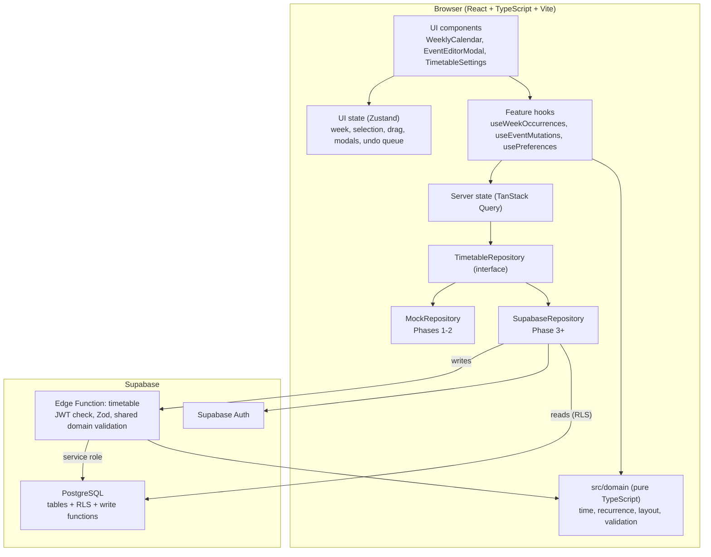
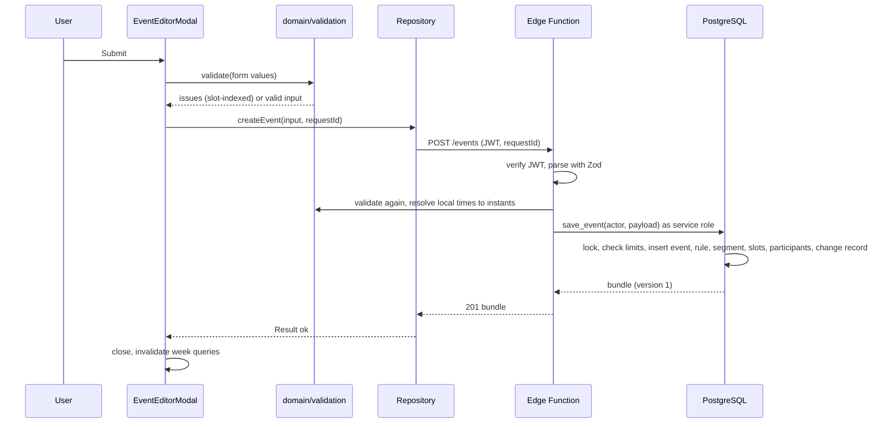
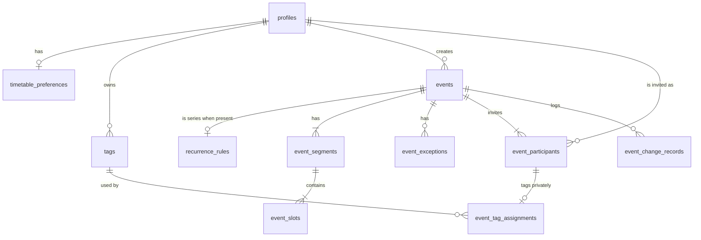
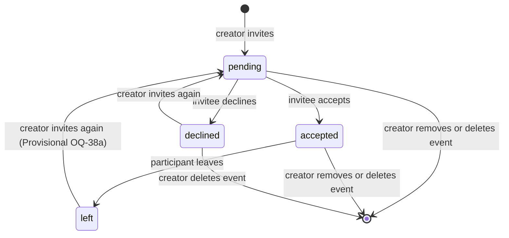
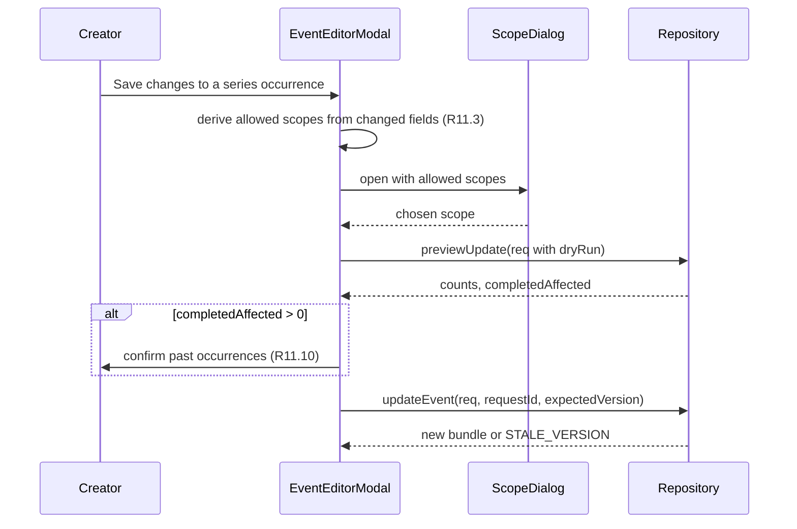
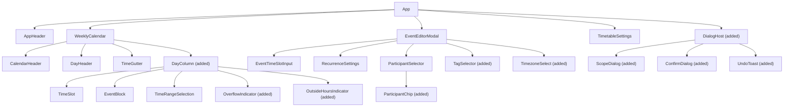

# Design: Personal Weekly Timetable

Status: DRAFT v1, awaiting review. Based on `requirements.md` v4. `tasks.md` is not started. No implementation code exists or is written here.

## 0. Inputs inspected and what they mean for the design

| Input | Finding | Consequence |
|---|---|---|
| Source code | None. No `package.json`, `src/`, `supabase/` or `tests/` | Everything is greenfield. Phase 1 starts with project scaffolding |
| Database schema | None | The schema in section 4 is proposed, not extending anything |
| Authentication | None. `.kiro/specs/authentication/` is empty | Phase 3 depends on a spec that does not exist yet (section 12). Phases 1 and 2 run without auth |
| Steering | Unchanged since v4 requirements. `tech.md` still says 5-minute resolution, one tag per task, owner-only privacy | Steering updates S-1 to S-7 (requirements 2.3) are prerequisites. Section 13 adds three more |
| Figma | Not readable in this session | Component names come from the brief. Every Figma mapping is `[unverified]`. No pixel values appear here |
| Requirements | OQ-36 to OQ-42 still open | Design uses the proposed defaults, marked **Provisional**, each isolated so it can change cheaply |

Conventions: `[F]` Figma value to confirm. **Provisional (OQ-n)** a decision taken from a proposed default. `Rx.y` links to a requirement.

## 1. Technical decisions

| ID | Decision | Alternatives considered | Why |
|---|---|---|---|
| D-1 | **Custom calendar grid**, not FullCalendar (deviation from `tech.md`) | FullCalendar timeGrid with the Luxon plugin | Requirements need: per-day `+N more` with a custom order (R4.6 to R4.8), keyboard cell cursor (R21.2), tiered compact blocks (R5.9), 5-minute rows over 24 hours (R19.5), wall-clock geometry on DST days, and the component list in the brief (DayHeader, TimeGutter, TimeSlot). FullCalendar's DOM and keyboard model would be fought on each. Cost: we write the grid, layout and hit-testing ourselves. **Needs your approval and a steering edit** |
| D-2 | **Luxon** for zone conversion, plus one in-house **resolver** for DST gaps and repeated hours | `@js-temporal/polyfill`, `date-fns-tz` | Luxon is small and handles IANA zones through `Intl`. Temporal's disambiguation modes do not give "first valid time after the gap" (OQ-36 default). One resolver function keeps the policy in one place |
| D-3 | **TanStack Query** for server state | Hand-written cache with Zustand | Needs cancellation (R2.6), caching (R19.2), retry, optimistic updates, mutation state. Steering says to separate UI state from server data. **New dependency, needs approval** |
| D-4 | **Writes go through one Edge Function; database write functions are callable only by the service role** | Direct table writes under RLS; direct RPC from the browser | DST and recurrence validation live in TypeScript. If the browser could call write RPCs directly it could bypass them. Reads use RLS. Participant responses use a user-callable RPC (no DST logic) |
| D-5 | **Recurrence is stored as rules and expanded at read time** in the browser from a shared pure module | Store one row per occurrence; expand in SQL | No duplicate rows (brief). One DST implementation instead of two. Server needs expansion only for busy-time (separate spec) and can reuse the same module |
| D-6 | **Shared domain module** in `src/domain`, imported by the Edge Function through an import map | Duplicate logic; build-time copy | Single source of truth. **Risk R-1** (section 13): verify Supabase bundling of imports outside `supabase/functions`. Fallback: a generated copy |
| D-7 | **Wall-clock geometry**: blocks are positioned by local clock time of the display timezone, not elapsed time | Elapsed-time geometry | The gutter labels are the same for all seven columns, so DST days must use the same wall-clock axis. On the two DST days a block that spans the transition is drawn slightly differently from its elapsed duration (section 3.6) |
| D-8 | **Tags assigned in their own table** (`event_tag_assignments`), not on the participant row | Tag column on `event_participants` | The creator can read all participant rows. A tag column would leak other users' tags (R17.5) |
| D-9 | **Undo by deferred commit** for personal events | Soft delete with a purge job | No `deleted_at` filter on every query and no scheduled job. Cost: a closed tab flushes the delete on `pagehide`. Shared events delete immediately (**Provisional OQ-41**) |
| D-10 | **TimeSlot is a virtual cell.** Grid lines come from CSS, pointer position maps to minutes, and one cursor `TimeSlot` is rendered for hover and focus | One DOM cell per slot (up to 2016 at 5 minutes over 24 hours) | Keeps DOM small and screen-reader output usable. Fallback if the virtual approach fails a spike: memoized per-slot cells behind the same `TimeSlot` interface |
| D-11 | **No Realtime** in this feature | Supabase Realtime | Requirements dropped live sync (decision OQ-13 in v3). Refetch on focus and after mutations is enough |
| D-12 | **Idempotency by `request_id`** stored in the change record | Idempotency table | Reuses the change record needed for notifications (R18.6) |
| D-13 | **Form values keep both date and weekday per slot** | Convert and discard | Required by R8.8 (no value lost across Repeat toggles) |
| D-14 | **Calendar arithmetic uses a zone-free civil date** (`LocalDate`, `YYYY-MM-DD`) and converts to instants only through the resolver | Arithmetic on `Date` or instants | Week navigation across months, years and DST cannot be affected by the machine timezone (R14.20) |

New runtime dependencies proposed: `luxon`, `@tanstack/react-query`, `react-hook-form`, `zod`. All other tooling is from steering.

## 2. Architecture

### 2.1 Layers



Rules:
- Components never import `MockRepository` or `SupabaseRepository`. They receive a `TimetableRepository` through a React context (R18.1).
- `src/domain` has no React, DOM, Supabase or Node imports. It runs in the browser, in Vitest and in the Edge Function (Deno).
- UI state (what is open, selected or being dragged) lives in Zustand. Server data (events, preferences) lives only in TanStack Query. Form state lives in React Hook Form.

### 2.2 Folder layout (follows `structure.md`)

```
src/
  domain/                      pure logic, no framework imports
    time/                      civil dates, zone conversion, DST resolver, week range, day split
    recurrence/                slot expansion, exceptions, scope operations
    layout/                    overlap clustering, overflow, density, hit-testing
    validation/                event input rules, issue codes
    format/                    time, header and date formatting (locale aware)
  features/timetable/
    data/                      TimetableRepository, types, mock/, supabase/
    store/                     Zustand slices
    hooks/
    components/                calendar/, editor/, settings/, shared/
    messages/                  English message catalogue
  features/tags/               tag selector contract only (tag management is separate)
  lib/supabase/                client
supabase/
  migrations/                  schema, constraints, RLS, functions
  functions/timetable/         Edge Function; deno.json import map
tests/e2e/                     Playwright
```

### 2.3 Request flow for a write (create event)



If the same `requestId` arrives again, `save_event` finds the change record and returns the existing bundle (R7.22).

## 3. Scheduling and Timezone Logic (`src/domain`)

### 3.1 Core types

```ts
type LocalDate = string;      // 'YYYY-MM-DD', no zone. Calendar math only
type Instant = string;        // ISO-8601 UTC, whole minutes
type Weekday = 1|2|3|4|5|6|7; // Monday = 1
type MinuteOfDay = number;    // 0..1440 (1440 only as an end)

interface LocalSlotTime { startMinute: MinuteOfDay; endMinute: MinuteOfDay }
interface Occurrence {
  key: string;                // stable identity (3.5)
  eventId: string;
  title: string;
  startsAt: Instant;
  endsAt: Instant;
  isException: boolean;       // individually modified
}
```

### 3.2 Storage and conversion rules (R14.1, R14.2)
- Every instant is stored in UTC with whole-minute precision (seconds are 0).
- Each event stores its **event timezone** (IANA name) at creation. It is immutable (`A-15`).
- **One-time slots store instants** (`starts_at`, `ends_at`). The editor shows them by converting to the event timezone. A slot ending at the next local midnight is shown as `24:00` on its start date.
- **Recurring slots store wall-clock rules** (`weekday`, `start_minute`, `end_minute`) in the event timezone. Instants are produced only by expansion.
- The browser sends wall-clock input (date or weekday, minutes, event timezone). The server resolves it to instants itself and never trusts client instants.
- Formatters are cached per timezone and locale. Constructing `Intl.DateTimeFormat` per block is too slow for 500 occurrences (R19.4).
- Clock access goes through an injectable `Clock` so tests control "now" (R14.20).

### 3.3 The DST resolver (R7.13, R7.14, R8.19, R14.16)
One function converts a local date and minute in a zone to an instant. Every other module uses it.

`resolveLocal(date, minuteOfDay, zone, context) -> { kind, instant }`

| Case | Detection | `context = 'oneTime'` | `context = 'series'` |
|---|---|---|---|
| Normal | exactly one instant has that local time | that instant | that instant |
| Repeated hour (fall-back) | two instants have that local time | the earlier one (R7.14) | the earlier one (R8.19) |
| Gap (spring-forward) | no instant has that local time | `kind = 'nonexistent'`, reject with a message (R7.13) | first valid local time after the gap (**Provisional OQ-36a**) |
| Minute 1440 | treated as 00:00 of the next date | same | same |

Detection method: take the wall time as if it were UTC, try the zone offsets in force one day before and one day after, and keep the candidates whose own offset matches. Zero candidates is a gap and two is a repeated hour. For a gap, binary-search the transition instant to the minute and return it.

**End-time handling (Provisional OQ-36b), series only.** Resolve start and end independently. If the resolved end is not later than the resolved start, set `end = start + nominal duration`, where nominal duration is `endMinute - startMinute`.

Worked examples (America/New_York):

| Input | Result | Instants (UTC) |
|---|---|---|
| Series 02:30 to 03:30 on 2026-03-08 (gap) | 03:00 to 03:30 EDT, 30 minutes | `07:00Z` to `07:30Z` |
| Series 02:15 to 02:45 on 2026-03-08 (both in gap) | start 03:00, end resolves to 03:00, so end = start + 30 min = 03:30 EDT | `07:00Z` to `07:30Z` |
| One-time 02:30 on 2026-03-08 | rejected: nonexistent | none |
| One-time or series 01:30 on 2025-11-02 (repeated) | earlier, 01:30 EDT | `05:30Z` |
| Series 01:00 to 02:00 on 2025-11-02 | start 01:00 EDT (`05:00Z`), end 02:00 EST (`07:00Z`) | 2 hours elapsed |
| Series Tuesday 09:00 to 10:00, 2025-03-04 and 2025-03-11 | 09:00 local both times | `14:00Z`, then `13:00Z` (R14.7) |

**Changing the policy.** If OQ-36a is answered "same offset into the new hour" (03:30), only the gap branch of this function changes. The test table above is the specification, and it is the first thing to update.

### 3.4 Week and day boundaries (R14.9, R14.10, R14.12)
- `startOfDay(date, zone)` is `resolveLocal(date, 0, zone, 'series')`. If 00:00 does not exist (a zone with DST at midnight), the day starts at its first valid time (R14.12).
- `weekRange(mondayDate, zone)` returns `[startOfDay(monday), startOfDay(monday + 7 days))`. Adding days is done on `LocalDate`, not on instants, so the range is 167 or 169 hours on DST weeks and never `+168h` (R14.9).
- Intervals are half-open. An occurrence belongs to the week if `start < weekEnd AND end > weekStart` (R14.10).
- `mondayOf(date)` and `addWeeks(date, n)` use civil-date arithmetic. Month and year changes need no special handling because they never touch an instant.
- Navigable range: `NAV_MIN = 1900-01-01`, `NAV_MAX = 2200-12-31` (design constants). At the limit the control is inactive with a message (R2.9).
- "Today" is `localDateOf(clock.now(), displayZone)`. The Today control is inactive when `mondayOf(today) === visibleMonday` (`A-2`).

### 3.5 Occurrence identity
| Kind | Key | Notes |
|---|---|---|
| One-time slot | `eventId:slot:<slotId>` | The slot is the occurrence |
| Series occurrence | `eventId:<originalLocalDate>:<originalStartMinute>` | Independent of slot ids, so it survives slot replacement (OQ-37 handling, section 6.4) |

Two slots of one weekday cannot overlap (R7.17), so `(date, startMinute)` is unique within an event.

### 3.6 Day split and geometry (R5.15, R3.3, R3.4)
- `splitByLocalDay(occurrence, displayZone)` returns one segment per local day touched: `{ date, startMinute, endMinute, continuesBefore, continuesAfter }`. The minute coordinates come from the **wall-clock** time of the display timezone, and the final segment ends at 1440.
- Every segment keeps the occurrence key. Its label text always shows the occurrence's full original range (decision OQ-19, C-1). Example: Seoul Monday 08:00 to 10:00 (`2025-01-12T23:00Z` to `2025-01-13T01:00Z`) viewed in UTC gives Sunday `23:00 to 24:00` and Monday `00:00 to 01:00`, both labeled `23:00–01:00`.
- Geometry: `top = (startMinute - visibleStart) * pxPerMinute` and `height = (endMinute - startMinute) * pxPerMinute`. `pxPerMinute = rowHeightPx[interval] / interval`, with `rowHeightPx` from Figma `[F]`. Positions never depend on the interval, only the scale does (R3.5, R3.6).
- Blocks are clipped to the visible range. If a segment lies partly or fully outside, the day column gets an outside-hours indicator at the matching edge (R3.11, R3.12). Clipping changes the drawn rectangle, never the label text (R3.14).
- **DST days and D-7.** The gutter is one wall-clock axis for all seven columns. On a spring-forward day nothing exists in the skipped hour, so that band stays empty. On a fall-back day the repeated hour has two real hours of events at the same wall-clock positions, so they are drawn overlapped and the layout in 3.8 spreads them side by side. A block spanning the transition is drawn from wall-clock start to wall-clock end, so its height differs from elapsed time by one hour. Displayed durations (details, accessible names) use elapsed time (R14.11). This is the only place R3.4 and R14.11 differ, and it is limited to the two transition days per year.

### 3.7 Recurrence expansion within the visible range (R8.16, R8.17, R8.24)
`expandBundle(bundle, window: [Instant, Instant)) -> Occurrence[]`

1. **One-time event:** each slot becomes an occurrence if `starts_at < windowEnd AND ends_at > windowStart`.
2. **Series:** convert the window to a local date range in the event timezone, widened by one day on each side (a display-timezone day can overlap two event-timezone days). Then for each segment and each slot:
   1. Walk dates in `[max(repeat_from, segment.valid_from.date), min(repeat_until, segment.valid_until.date)]` whose weekday equals the slot weekday.
   2. Keep a date only if the pair `(date, startMinute)` is `>= segment.valid_from` and `< segment.valid_until` (these are local timestamps, so a segment can begin mid-day, R11.6).
   3. Resolve start and end with `resolveLocal(..., 'series')` and apply the end rule from 3.3.
   4. Apply exceptions by `(date, startMinute)`: `cancelled` drops it, `modified` replaces its instants and title.
3. **Moved occurrences:** an exception whose override instants fall in the window is included even when its original date is outside the series range or window.
4. Drop anything that does not intersect the window, then sort by `(startsAt, endsAt DESC, key)`.

Cost is bounded: one week touches at most 20 slots times about 3 dates. Expansion over a 500-occurrence week is dominated by `resolveLocal`, so results for each `(date, minute, zone)` are memoized.

First occurrence rule: if Repeat From is after the slot's weekday in its week, the first date is the next matching weekday on or after Repeat From (R8.17). A slot with no matching date in range is rejected at validation (R8.18).

### 3.8 Overlap layout (R4)
`layoutDay(segments, columnWidthPx, config) -> { placed[], overflow[] }`, run per day column on wall-clock minutes.

1. Sort by start ascending, end descending, then key (R4.8).
2. **Cluster:** sweep in order, starting a new cluster when `start >= max end of the current cluster`. Touching blocks (`start == end`) do not join (R4.1).
3. **Columns:** inside a cluster, place each block in the lowest column whose last end is `<= start`. `columnCount` is the highest column used plus one. Blocks that do not overlap anything use the full width (R4.5).
4. **Width limit:** `maxColumns = max(1, floor(columnWidthPx / minBlockWidthPx))`, where `minBlockWidthPx` comes from Figma `[F]`. This applies to every viewport (R4.6).
5. If `columnCount > maxColumns`, columns `0..maxColumns-2` are drawn and the last column becomes an `OverflowIndicator` for the cluster, labeled `+N more`, where N is the count of occurrences in the hidden columns. The indicator opens a list of those occurrences, each selectable (R4.7).
6. Output is a pure function of its inputs, so the same set always gives the same arrangement (R4.9).

Chain overlap (A overlaps B, B overlaps C, A and C do not) is one cluster, and A and C may share a column (R4.4).

### 3.9 Density tiers and hit-testing (R5.9 to R5.12)
- `densityFor(heightPx)` returns one of `full` (title, time, team), `titleTime`, `single` (title and indicator on one line), `minimal` (indicator only). Thresholds are Figma constants `[F]`. Lines are removed in the order team, then time, then the title shortens (R5.9).
- Blocks always clip their content (`overflow: hidden`), so text cannot leave the block (R5.10). Full details come from the modal and the accessible name.
- `hitTest(point, placedBlocks, minTargetPx)` is pure. It returns the block whose drawn rectangle contains the point. If none does, it returns the nearest block whose rectangle expanded to the minimum target contains the point. Drawn rectangles always win over expanded areas (R5.12). Press handling in a day column uses it, so a press on a block (or its expanded area) never starts a time-range selection (R6.9).

### 3.10 Header text (R1.3 to R1.6, R20.2)
- `formatWeekHeader(monday, locale)` builds the text from `Intl.DateTimeFormat` parts for month names and numbers, joined by a locale pattern table (English pattern: `{months} {year} — {dayRange}`).
- Same month: `November 2026 — Nov 9–15`. Two months: `Nov–Dec 2026 — Nov 30–Dec 6`. Two years: `Dec 2026–Jan 2027 — Dec 28–Jan 3`. The separator style is `[F]`.
- No week number is computed anywhere.

### 3.11 Form logic (pure functions in `domain/validation` and `domain/forms`)
- `applyRepeatToggle(values, on)` implements R8.4 to R8.9. Slots always carry `date`, `weekday`, `startMinute`, `endMinute`. Turning Repeat on fills `weekday` from `date` only when `weekday` was never set by the user. Turning it off leaves `date` as it was. Nothing is deleted.
- `defaultRepeatUntil(from)` returns the same day three months later, clamped to the last day of that month (R8.12). `maxRepeatUntil(from)` returns the same day two years later, clamped the same way (R8.14).
- `validateEventInput(input, ctx)` returns issues, each `{ code, path, slotIndexes? }`. Codes: `TITLE_REQUIRED`, `TITLE_TOO_LONG`, `SLOT_END_NOT_AFTER_START`, `SLOT_START_AT_24`, `SLOT_NONEXISTENT_TIME`, `SLOTS_OVERLAP` (with both indexes), `SLOT_LIMIT`, `REPEAT_RANGE_INVALID`, `REPEAT_RANGE_TOO_LONG`, `SLOT_NO_OCCURRENCE`, `WEEKDAY_REQUIRED`, `DATE_REQUIRED`, `PARTICIPANT_LIMIT`, `TIMEZONE_INVALID`.
- Rules that depend on Repeat state ignore hidden fields (R15.22).
- The same function runs in the browser and in the Edge Function (R15.16).

## 4. Data Model

### 4.1 Distinguishing the concepts

| Concept | Where it lives | Stored? |
|---|---|---|
| **Event** (identity, owner, event timezone, team) | `events` | Yes, one row per event |
| **Event series** (an event with Repeat ON) | `events` + one `recurrence_rules` row | Yes, one set of rows regardless of length |
| **Schedule segment** (title and slots valid for a range of local time) | `event_segments` | Yes. One for a plain event. More only after "This and following" edits |
| **Individual time slot** (one date or weekday and one time range) | `event_slots` | Yes |
| **Occurrence** (one concrete block on the calendar) | Computed by `expandBundle` | One-time slots are stored instants. Series occurrences are never stored |
| **Recurrence exception** (one occurrence cancelled or changed) | `event_exceptions` | Yes, only for occurrences that differ |
| **Participant invitation** (a user's relationship to the event) | `event_participants` | Yes, one row per user, creator included |
| **Tag assignment** (the viewer's own tag for an event) | `event_tag_assignments` | Yes, private to the assigning user |

A 2-year weekly series with three weekday slots stores one `events` row, one `recurrence_rules` row, one segment and three slots (and exceptions only for edited occurrences). It never stores its roughly 300 occurrences.

### 4.2 Entity relationships



### 4.3 Tables

Names are `snake_case` (`structure.md`). `uuid` keys default to `gen_random_uuid()`. All timestamps are `timestamptz` in UTC unless marked local.

**`profiles`** (owned by the Authentication spec; required columns listed). `id uuid PK -> auth.users`, `username text unique`, `display_name text`. Decision D-A: the Authentication spec owns this table and is written before Phase 3. No stub migration is added.

**`timetable_preferences`** (one row per user, all fields nullable, null means default)
| Column | Type | Constraint |
|---|---|---|
| `user_id` | uuid PK, FK profiles | |
| `time_zone` | text null | valid IANA name (trigger against `pg_timezone_names`) |
| `time_format` | text null | `'12h'` or `'24h'` |
| `interval_minutes` | smallint null | in (5, 15, 30) |
| `visible_start_hour` | smallint null | 0..23 |
| `visible_end_hour` | smallint null | 1..24, and greater than start when both set |
| `updated_at` | timestamptz | |

Row absent or a column null means "use the default" (R13.12, R13.14). "Reset to Defaults" sets all columns to null (R13.13). The client resolves the effective timezone as saved, else browser, else UTC (R14.17).

**`tags`** (owned by the tag management component; required columns). `id uuid PK`, `owner_id uuid FK profiles`, `name text`, `color_key text` (a palette key from the Figma design system, not a hex value), `unique (owner_id, lower(name))`, `unique (id, owner_id)`.

**`events`**
| Column | Type | Constraint |
|---|---|---|
| `id` | uuid PK | |
| `creator_id` | uuid FK profiles | not null |
| `time_zone` | text | valid IANA name, immutable (trigger blocks updates) |
| `is_recurring` | boolean | not null |
| `team_id` | uuid null | No foreign key yet. The Team Management spec adds it |
| `version` | integer | starts at 1, incremented by every write |
| `created_at`, `updated_at` | timestamptz | |
| unique `(id, is_recurring)` | | target of composite foreign keys below |
| unique `(creator_id, client_request_id)` | | `client_request_id uuid` for create idempotency |

**`recurrence_rules`**: `event_id uuid PK`, `is_recurring boolean default true check (is_recurring)`, foreign key `(event_id, is_recurring) -> events(id, is_recurring)`, `repeat_from date`, `repeat_until date`, `check (repeat_until >= repeat_from)`, `check (repeat_until <= (repeat_from + interval '2 years')::date)` (R8.13, R8.14). Both dates are local dates in the event timezone.

**`event_segments`**
| Column | Type | Constraint |
|---|---|---|
| `id` | uuid PK | |
| `event_id`, `is_recurring` | uuid, boolean | composite FK to `events(id, is_recurring)` |
| `title` | text | `char_length(btrim(title))` between 1 and 100 |
| `valid_from` | timestamp (local, no zone) null | not null if recurring, null if not |
| `valid_until` | timestamp (local) null | exclusive. Null means "to `repeat_until`" |
| exclusion | | no two segments of one event with overlapping `tsrange(valid_from, valid_until)` |

**`event_slots`**
| Column | Type | Constraint |
|---|---|---|
| `id` | uuid PK | |
| `segment_id`, `is_recurring` | uuid, boolean | composite FK to `event_segments(id, is_recurring)` (cascade). `event_segments` has `unique (id, is_recurring)` |
| `position` | smallint | unique per segment |
| `weekday` | smallint null | 1..7. Set only for recurring |
| `start_minute`, `end_minute` | smallint null | 0..1439 and 1..1440, `end > start`. Set only for recurring |
| `starts_at`, `ends_at` | timestamptz null | `ends_at > starts_at`. Set only for one-time |
| check | | `(weekday is not null) = is_recurring`, exactly one of the two groups is set, the other group is null |
| exclusion (recurring) | | no overlap of `(segment_id, weekday, int4range(start_minute, end_minute))` (R7.17, touching is allowed) |
| exclusion (one-time) | | no overlap of `(segment_id, tstzrange(starts_at, ends_at))` |
| limit | | at most 20 slots per segment (constraint trigger, R7.5) |

Exclusion constraints use `btree_gist` and are `DEFERRABLE INITIALLY DEFERRED` so a replace-all-slots write inside one transaction works.

**`event_exceptions`** (only for occurrences that differ from the rule)
| Column | Type | Constraint |
|---|---|---|
| `id` | uuid PK | |
| `event_id` | uuid FK (cascade) | |
| `original_date` | date (local) | the occurrence's generated local date |
| `original_start_minute` | smallint | its generated start minute |
| `kind` | text | `'cancelled'` or `'modified'` |
| `title` | text null | override, only for `modified` |
| `starts_at`, `ends_at` | timestamptz null | override instants, required for `modified` when the time changed |
| unique | | `(event_id, original_date, original_start_minute)` |

Modified times are stored as instants and follow the one-time rules (a gap is rejected, a repeated hour uses the earlier one), because the user typed a specific date and time.

**`event_participants`** (one row per user per event, creator included)
| Column | Type | Constraint |
|---|---|---|
| `event_id` | uuid FK (cascade) | |
| `user_id` | uuid FK profiles | PK is `(event_id, user_id)` |
| `status` | text | `'pending'`, `'accepted'`, `'declined'`, `'left'` |
| `invited_by` | uuid | |
| `invited_at`, `responded_at` | timestamptz | |

The creator has a row with status `accepted` that the write function creates and no function can change. The calendar query is "events where I have an `accepted` row", which is one path for creators and participants. The participant limit (R9.7) counts rows with status `pending` or `accepted` (**Provisional OQ-38b**) and is checked in the write function while the event row is locked.

**`event_tag_assignments`** (private to the assigning user)
`event_id`, `user_id`, `tag_id`, PK `(event_id, user_id)`, composite FK `(tag_id, user_id) -> tags(id, owner_id)` so a user can only use their own tags (R17.5). A deleted or missing tag means no indicator (**Provisional OQ-40c**).

**`event_change_records`** (transactional outbox and idempotency log)
`id`, `request_id uuid`, `actor_id`, `event_id` (no foreign key so records outlive a deleted event), `kind` (`created`, `updated`, `deleted`, `invited`, `accepted`, `declined`, `left`, `removed`, `scope_applied`), `targets uuid[]`, `payload jsonb` (ids and changed field names only, no titles), `created_at`, `consumed_at null`. `unique (actor_id, request_id)`. The Notifications spec reads rows with non-empty `targets` (R18.6). Rows are kept for the retention period that spec defines.

### 4.4 Indexes
- `event_participants (user_id) where status = 'accepted'`: calendar lookups.
- `event_slots using gist (tstzrange(starts_at, ends_at)) where starts_at is not null`: one-time range queries.
- `recurrence_rules using gist (daterange(repeat_from, repeat_until, '[]'))`: series range queries.
- `event_exceptions (event_id)`, `event_segments (event_id)`, `events (creator_id)`.

### 4.5 Participant status


Responses are idempotent: accepting an accepted invitation succeeds without change (R9.19).

### 4.6 Example: weekly series with one edited occurrence

Event "Study", Seoul timezone, Mon 09:00 to 10:30, Wed 14:00 to 15:30, repeat 2026-11-02 to 2027-02-02.
- `events`: 1 row. `recurrence_rules`: 1 row. `event_segments`: 1 row (title "Study", `valid_from` 2026-11-02 00:00). `event_slots`: 2 rows.
- The user moves the 2026-11-18 Wednesday occurrence to 15:00 to 16:00: one `event_exceptions` row `(2026-11-18, 840, modified, starts_at, ends_at)`. No other row changes.
- The user then edits the title "this and following" from 2026-12-02 14:00: the first segment gets `valid_until = 2026-12-02 14:00`, and a second segment starts at that timestamp with the new title and a copy of the slots (section 6.4).

## 5. Data-Access Contract and API

### 5.1 Repository interface (R18.1, R18.2)

```ts
interface TimetableRepository {
  getEventsInRange(range: { from: Instant; to: Instant }): Promise<Result<EventBundle[]>>;
  getEvent(eventId: string): Promise<Result<EventBundle>>;
  createEvent(input: EventInput, requestId: string): Promise<Result<EventBundle>>;
  updateEvent(req: UpdateRequest): Promise<Result<EventBundle>>;      // includes scope
  previewUpdate(req: UpdateRequest): Promise<Result<ChangePreview>>;  // counts only (R11.11)
  deleteEvent(req: DeleteRequest): Promise<Result<void>>;
  setMyTag(eventId: string, tagId: string | null): Promise<Result<void>>;
  respondToInvitation(eventId: string, r: 'accept'|'decline'|'leave'): Promise<Result<void>>;
  listPendingInvitations(): Promise<Result<InvitationSummary[]>>;     // for the future Invitations spec
  getPreferences(): Promise<Result<PreferencesRow>>;
  patchPreferences(patch: Partial<PreferencesRow>): Promise<Result<PreferencesRow>>;
  resetPreferences(): Promise<Result<PreferencesRow>>;
}
interface FriendDirectory { search(query: string): Promise<Result<UserSummary[]>> }  // Friend Management spec
interface TagDirectory   { listMine(): Promise<Result<Tag[]>> }                     // tag management component
```

`Result<T>` is `{ ok: true, value } | { ok: false, error }`. Error codes: `VALIDATION` (with issues), `FORBIDDEN`, `NOT_FOUND`, `STALE_VERSION`, `LIMIT_EXCEEDED`, `UNAVAILABLE`.

`EventBundle` is everything needed to expand and render one event for one viewer: `event` (id, creatorId, timeZone, isRecurring, teamId, version), `rule?`, `segments[]` (with `slots[]`), `exceptions[]`, `creator` (id, display name), `myStatus`, `myTagId`, `participants[]` (shaped per viewer, see 9.3) and `team?` (id, name, from the Team interface when it exists).

`UpdateRequest`: `{ eventId, expectedVersion, requestId, scope: 'event'|'occurrence'|'following'|'series', occurrenceKey?, patch, dryRun? }`. `'event'` is used for non-recurring events.

**Mock implementation (Phases 1 and 2).** Stores rows in the same normalized shape as section 4 in memory, calls the same domain validation and resolver, and can simulate latency, failure and stale-version responses (R18.3). Contract tests run against both implementations (section 10).

### 5.2 Wire API (Phase 3 onward)

| Operation | Transport | Authority |
|---|---|---|
| Read events in range | RPC `get_events_in_range(from, to)`, security invoker, RLS applies | Caller must be creator or accepted participant |
| Create event | Edge Function `POST /timetable/events` | JWT user is the creator |
| Update event, any scope | `PUT /timetable/events/:id` (`dryRun` for preview) | Creator only |
| Delete event, any scope | `DELETE /timetable/events/:id` with scope in the body | Creator only |
| Set my tag | Direct upsert on `event_tag_assignments` under RLS | Own row only, tag must be own |
| Accept, decline, leave | RPC `respond_to_invitation`, security definer, `auth.uid()` checked | The invited user |
| Pending invitations list | RPC `list_my_invitations()` returns limited fields | The invited user |
| Participants of an event | RPC `get_event_participants(event_id)` shaped for the caller | Creator or accepted participant |
| Preferences | Direct select, upsert and patch under RLS, with CHECK constraints and a timezone trigger | Own row only |

The Edge Function accepts JSON up to 64 KB, verifies the JWT with Supabase Auth, parses with Zod, runs `validateEventInput` from `src/domain`, resolves local times to instants, and calls `save_event`, `apply_event_update` or `delete_event_scope`. Those database functions are `SECURITY DEFINER`, have `search_path` set to empty, and have `EXECUTE` revoked from `anon` and `authenticated`, so only the Edge Function (service role) can call them (D-4). They re-check ownership with the `actor_id` the Edge Function passes, and re-check structural limits (title length, slot count, repeat range, participant count) as defense in depth.

HTTP mapping (`structure.md`): 400 or 422 `VALIDATION` with issue list, 401 no or bad token, 403 `FORBIDDEN`, 404 `NOT_FOUND`, 409 `STALE_VERSION`, 409 `LIMIT_EXCEEDED`, 503 `UNAVAILABLE`. Error bodies contain codes and field paths, never SQL or stack traces (R15.11).

### 5.3 Idempotency and retries (R7.22, R9.19, R11.14, R12.7)
- Every write carries a client-generated `requestId`. `unique (actor_id, request_id)` on `event_change_records` makes a repeated request return the current bundle instead of applying twice.
- A repeated update with the old `expectedVersion` but a known `requestId` returns success with the current state. An unknown `requestId` with a stale version returns 409.
- Delete of a missing event returns success. Responses are state transitions that no-op when already applied.

## 6. Event CRUD

### 6.1 Create (R7, R8, R9)
1. The editor produces `EventInput`: `title`, `timeZone`, `tagId?`, `repeat?` (`from`, `until`), `slots[]` (each `{ date | weekday, startMinute, endMinute }`), `participantIds[]`.
2. Validation runs in the browser, then again in the Edge Function (section 3.11).
3. `save_event` runs in one transaction: insert `events` (version 1), `recurrence_rules` if repeating, one `event_segments` row, the `event_slots` rows, a creator `event_participants` row (`accepted`), a `pending` row per participant, an `event_tag_assignments` row if a tag was chosen, and one `event_change_records` row (`created`, plus `invited` records for each participant).
4. Participant checks inside the transaction: not the creator, no duplicates, each is a friend of the creator (through the Friend Management interface, section 12), count of creator plus participants at most 6.
5. The response is the new `EventBundle`. The browser invalidates the affected week queries (R7.20).

### 6.2 Retrieve events for the visible week (R1, R14, R19)
1. `useWeekOccurrences(visibleMonday)` computes `weekRange` in the display timezone and requests `get_events_in_range(from, to)`. The query key is the UTC window, so changing the display timezone refetches (R14.5).
2. The function returns events where the caller has an `accepted` row and either a one-time slot intersects the window, or a series' local date range intersects the window (converted per event timezone, widened by one day), or an exception's override instants intersect it.
3. The hook expands bundles (3.7), splits by local day (3.6), lays out each day (3.8), and returns day columns. Expansion and layout are memoized on the bundle list, display timezone, interval-independent inputs and column width.
4. Pending and declined events are never returned to the caller's calendar (R9.10), because only `accepted` rows qualify.

### 6.3 Update a one-time event (scope `'event'`)
Replaces title, slots, tag and participants in one transaction (`apply_event_update`), with `expectedVersion` checked while the event row is locked `FOR UPDATE`. Slots are replaced as a set and positions are renumbered. Participant changes: new ids become `pending`, removed ids are deleted (R9.17), existing ids keep their status (R9.16). Version increments. A stale version returns 409 and the editor shows the latest data (R10.3).

### 6.4 Update or delete a recurring event by scope (R11)
Let the selected occurrence start at local timestamp `b = (date, startMinute)` in the event timezone.

| Scope | Edit effect | Delete effect |
|---|---|---|
| **Occurrence** | Upsert an exception `(date, startMinute)` with `modified`, the new title and new instants (resolved with the one-time rules) | Upsert an exception `cancelled` |
| **Following** | Find the segment containing `b`. If `b` equals its `valid_from`, edit it in place. Otherwise set its `valid_until = b`, insert a new segment from `b` with the new title and slots (copy of the old slots with edits applied). Delete segments that started after `b` and extend the new segment to cover them. Re-key exceptions after `b` (below) | Set `valid_until = b` on the containing segment and delete segments starting after `b`. If `b` is the series' first timestamp, delete the event (R11.7). Delete exceptions at or after `b` |
| **Series** | Update all segments' titles. If slots change, collapse to one segment covering the whole rule with the new slots. Changes to `repeat_from`, `repeat_until`, Repeat on or off, and participants are allowed only here (R11.3). Re-key exceptions (below) | Delete the event |

**Which fields allow which scope** is enforced server-side from the patch (R11.3): title or slot start and end, all three; slot add, remove or weekday change, Following and Series; repeat range, Repeat toggle, participants, Series only. A request with a disallowed combination returns `VALIDATION`.

**Re-keying exceptions** (**Provisional OQ-37**). After a schedule edit, each existing exception is matched by `(original_date, original_start_minute)` against the newly generated occurrences. A match keeps the exception: fields the user changed individually stay (individual changes win). No match means the occurrence's origin no longer exists, so the exception is removed. `previewUpdate` returns `{ created, removed, kept, exceptionsRemoved, completedAffected }` so the confirmation can state counts (R11.10, R11.11).

**Completed occurrences (`A-14`).** `completedAffected` counts affected occurrences whose end is `<= now`. If it is above zero the editor shows the past-occurrence confirmation before sending the real request (R11.10).

**Converting between one-time and series** (R8.21, R8.22): `apply_event_update` with scope `series` can flip `is_recurring`. It deletes all slots, segments, rules and exceptions, then inserts the new shape in the same transaction. The preview counts both sides. Only Series scope may do it.



### 6.5 Delete and undo (R12)
- Non-recurring with several slots: ask "this time slot" or "entire event". Deleting the only slot deletes the event (R12.3, R12.4).
- Recurring: the scope question and delete confirmation appear together (R12.2).
- **Personal events:** the UI hides the occurrences at once and starts a pending-delete entry in the Zustand store with a timer (the Undo period, default 8 seconds, `A-16`). Undo cancels the entry and restores the cached data. When the timer ends, or on `pagehide`/unmount, the real delete is sent with its `requestId` (fetch with `keepalive`). Nothing is written before then, so "restore exactly" is trivially true (R12.9).
- **Events with participants:** the delete is sent immediately, there is no Undo, and the confirmation text says it cannot be undone (R12.10, **Provisional OQ-41**).
- Deleting an event cascades to slots, segments, rule, exceptions, participants and tag assignments, and writes a `deleted` change record with the participant ids as targets (R9.22).
- Failure restores the event in the UI and shows an error (R12.8).

### 6.6 Slots, participants, invitations
- **Add or remove slots:** only through event update (6.3, 6.4). The form enforces 1 to 20 slots (R7.5, R7.6).
- **Add or remove participants:** only through update with Series scope for series, or scope `'event'` otherwise. A removed participant's accepted calendar entry disappears because their `accepted` row is gone (R9.17).
- **Accept, decline, leave:** `respond_to_invitation(event_id, response)`, callable by the invited user. It locks the participant row, returns `NOT_FOUND` if the event or row is gone (R9.21), no-ops if already in the target state (R9.19), and writes a change record. `leave` is allowed only from `accepted` and acts on the whole series (R9.18).
- **Re-invite:** a creator update that adds a user in status `declined` or `left` sets the row back to `pending` (R9.13).
- **Integration points for later specs:** `list_my_invitations()` and `respond_to_invitation()` are the contract for the Invitations screen. `event_change_records` is the contract for Notifications. `FriendDirectory` and `TagDirectory` are the contracts for their features.
- **Team association:** `events.team_id` and the `team` field in the bundle are filled by the Team spec. Until then they are always null (R9.25).

## 7. Component Architecture

Component names come from the brief. The Figma frames were not readable, so every "Figma" column entry is `[unverified]`. Components marked **added** are not in the brief's list and need a Figma counterpart (requirements 2.2).

### 7.1 Component tree



`EventEditorModal` is one component for create, edit and read-only modes (brief, requirement R7.25, R10.7). The mode changes which fields are enabled, never which component renders.

### 7.2 Component responsibilities and interfaces

Types shown are the contract, not implementation. `LocalDate`, `Instant` come from 3.1.

| Component (Figma) | Responsibility | Props | Owns state | Notes |
|---|---|---|---|---|
| **AppHeader** (`[unverified]`) | App chrome: Add Event button (R6.14), settings entry, slot for the auth user menu | `{ onAddEvent(): void; onOpenSettings(): void; userMenu?: ReactNode }` | none | The user menu belongs to the Authentication spec |
| **WeeklyCalendar** | Container. Reads preferences and week data, owns scroll container, measures column width, wires interactions | `{}` (reads hooks) | scroll position (DOM), column width (ResizeObserver) | Composes everything below. Only component that talks to query hooks for the grid |
| **CalendarHeader** | Month, year, range text and previous, next, Today controls (R1, R2) | `{ monday: LocalDate; locale: string; isCurrentWeek: boolean; canPrev: boolean; canNext: boolean; onPrev(): void; onNext(): void; onToday(): void }` | none | Sticky (R3.8). Header text announced via `aria-live="polite"` (R21.6) |
| **DayHeader** | Weekday and date for one day (R1.8) | `{ date: LocalDate; locale: string; isToday: boolean; hasOutsideHours?: boolean }` | none | Sticky row (R3.8) |
| **TimeGutter** | Time labels down the left (R1.1, R5.2 format) | `{ rows: { minute: MinuteOfDay; label: string }[]; pxPerMinute: number; sticky: boolean }` | none | Sticky when the grid scrolls horizontally (R3.9). Labels come from `formatTime` |
| **DayColumn** (added) | One day: grid lines, pointer handling, block layer, selection overlay, indicators | `{ date: LocalDate; layout: DayLayout; visibleStart: number; visibleEnd: number; pxPerMinute: number; interval: Interval; onCreate(range: DayRange): void; onSelect(key: string): void }` | pointer session (refs) | Runs `hitTest`, click-vs-drag, long press. Lines drawn with CSS background |
| **TimeSlot** | The cursor cell: hover and keyboard focus marker for one slot (D-10) | `{ date: LocalDate; startMinute: number; interval: Interval; variant: 'hover'\|'focus'; label: string }` | none | At most one per day column. `id` used by `aria-activedescendant` |
| **EventBlock** | One occurrence segment: title, tag indicator, times, team, states (R5) | `{ item: PlacedBlock; state: 'default'\|'hover'\|'selected'; density: Density; timeFormat: '12h'\|'24h'; locale: string; onSelect(key: string): void }` | hover (local) | `React.memo` keyed by block id, geometry, state, format. Tag color is a CSS variable from the palette key |
| **TimeRangeSelection** | Live preview during drag (R6.4, R15.5) | `{ startMinute: number; endMinute: number; pxPerMinute: number; timeFormat; label: string }` | none (props from drag store) | Positioned with a transform so drag does not reflow the grid |
| **OverflowIndicator** (added) | `+N more` and its list (R4.6, R4.7) | `{ items: PlacedBlock[]; onSelect(key: string): void }` | open state (local) | Popover on desktop, sheet on mobile `[F]`. Keyboard operable |
| **OutsideHoursIndicator** (added) | Edge marker for clipped events (R3.12) | `{ edge: 'top'\|'bottom'; count: number }` | none | `aria-label` states events exist outside the visible hours (R3.13) |
| **EventEditorModal** | Create, edit, read-only (R7, R10) | `{ mode: 'create'\|'edit'\|'readonly'; initial: EventFormValues; bundle?: EventBundle; onSubmit(v: EventFormValues, scope?: Scope): Promise<Result<void>>; onClose(): void; onDelete?(): void; onLeave?(): void; onTagChange(id: string\|null): void }` | form state (React Hook Form) | Dirty-guard on close (R7.21). Focus trap and return (R21.5) |
| **EventTimeSlotInput** | One slot row: date or weekday, start, end, remove (R7.5 to R7.12, R8) | `{ index: number; repeat: boolean; control: Control<EventFormValues>; timeFormat; errors?: SlotIssue[]; canRemove: boolean; onRemove(): void }` | none (form-controlled) | Shows date picker when Repeat is off, weekday select when on. Times at 1-minute precision |
| **RecurrenceSettings** | Repeat toggle and the From and Until pickers (R8) | `{ control; timeZone: string; onToggle(on: boolean): void; errors? }` | none | Calls `applyRepeatToggle` (3.11). Pickers hidden, not cleared, when off (R8.8) |
| **ParticipantSelector** | Friend search, chips, limit (R9) | `{ value: ParticipantChipData[]; onChange(v): void; search(q: string): Promise<Result<UserSummary[]>>; limit: number; statuses?: Record<string, ParticipantStatus>; disabled?: boolean }` | query text, results, search status | Search starts at 2 characters (R9.1). Never shows email or phone (R9.2) |
| **TimetableSettings** | Interval, format, visible hours, timezone, Reset (R13) | `{ prefs: EffectivePreferences; onChange(patch: PreferencesPatch): void; onReset(): void; saving: boolean; error?: string }` | none | Applies immediately (R13.2). Visible start and end hours validated together (R13.7) |
| **TagSelector** (added) | Choose own tag, none allowed | `{ value: string\|null; tags: Tag[]; onChange(id: string\|null): void; disabled?: boolean }` | none | Reads `TagDirectory`. No tag creation in this spec (**Provisional OQ-40a**) |
| **TimezoneSelect** (added) | IANA zone picker, name visible (R7.16) | `{ value: string; onChange(z: string): void; disabled?: boolean }` | search text | Used for event timezone and for the settings timezone. Disabled for existing events (`A-15`) |
| **ScopeDialog** (added) | Occurrence, Following, Series choice with only allowed options (R11.1, R11.3) | `{ allowed: Scope[]; action: 'edit'\|'delete'; preview?: ChangePreview; onChoose(s: Scope): void; onCancel(): void }` | none | |
| **ConfirmDialog** (added) | Delete, past-occurrence and discard confirmations | `{ kind: 'delete'\|'past'\|'discard'; details?: string; onConfirm(): void; onCancel(): void }` | none | |
| **UndoToast** (added) | Undo after delete, announced (R12.9, R21.7) | `{ message: string; remainingMs: number; onUndo(): void }` | none | Driven by the pending-delete store |

### 7.3 State ownership

| State | Owner | Why |
|---|---|---|
| Events, preferences, tags, friend search results | TanStack Query (through the repository) | Server data. Cached, cancelled and retried (R2.6, R19.2) |
| Visible Monday (`LocalDate`), selected occurrence key, which modal is open, scope dialog, pending deletes | Zustand `useTimetableUiStore` | UI state. The visible Monday is a civil date, so a timezone change does not move it (R14.5) |
| Drag or long-press selection (`dayDate`, `startMinute`, `endMinute`, `phase`) | Separate Zustand store `useSelectionStore`, read with selectors | High-frequency. Only `TimeRangeSelection` subscribes, so blocks do not re-render during a drag (R19.6) |
| Form values and errors | React Hook Form inside `EventEditorModal` | Local to the modal. Discarded on close (R7.21 guards it) |
| Pointer session (start point, timer id) | Refs inside `DayColumn` | Never triggers renders |
| Effective preferences | Derived: query result merged with defaults and the timezone rule (R14.17) | One `usePreferences()` hook. Components never read raw rows |

Preference writes are optimistic: update the cache, send a patch of only the changed field, and on failure roll back to the last saved value with an error (R13.15). A failed load shows an error state and never writes defaults back (R13.16).

### 7.4 Form model

```ts
interface SlotFormValue { id: string; date: LocalDate | null; weekday: Weekday | null; startMinute: number | null; endMinute: number | null }
interface EventFormValues {
  title: string; tagId: string | null; timeZone: string;
  repeat: boolean; repeatFrom: LocalDate | null; repeatUntil: LocalDate | null;
  slots: SlotFormValue[]; participants: ParticipantChipData[];
}
```
Both `date` and `weekday` stay on every slot at all times (D-13). `toEventInput(values)` drops the inactive one when building the request.

## 8. UI Integration

### 8.1 Layout strategy (R16)
- One responsive component tree. Breakpoint and the number of days visible at once on mobile come from Figma `[F]` and are two constants: `DESKTOP_MIN_WIDTH` and `MOBILE_VISIBLE_DAYS`.
- The grid is a horizontally scrollable strip of seven equal day columns inside a scroll container. On desktop all seven fit. On mobile the container shows `MOBILE_VISIBLE_DAYS` columns and scrolls horizontally with scroll-snap, and every day is reachable (R16.2). The gutter is sticky on the left (R3.9). Day headers and the toolbar are sticky at the top (R3.8).
- Column width is measured with `ResizeObserver` and passed to `layoutDay` so the overflow rule adapts to the real width (R4.6).
- Modals: `Dialog` on desktop, full-height sheet on mobile `[F]`. The footer stays above the on-screen keyboard (use dynamic viewport units and the visual viewport resize event, and scroll the focused field into view) (R16.5). Controls are at least 44 by 44 CSS pixels on mobile (R16.6). Rotation and resize keep the week, selection and form values because those live in stores and form state, not in layout (R16.4).

### 8.2 Interaction rules

| Input | Behavior |
|---|---|
| Click an event block | Open `EventEditorModal` (edit for the creator, read-only otherwise). The block is Selected while the modal is open and returns to Default on close with focus restored (R6.1, R6.2) |
| Click an empty slot | Open the modal in create mode, start at the slot's start, end 30 minutes later, capped at 24:00 (R6.3) |
| Press and drag on empty space (mouse or pen) | Movement over 4 px starts a selection. Preview follows the pointer, snapped to the interval, clamped to the start day and visible range. Release opens the modal. Escape cancels (R6.4 to R6.10) |
| Press on a block or its expanded hit area | Never starts a selection (R6.9) |
| Touch: scroll | Normal scroll. A touch that moves before the long-press timer fires cancels the timer (R6.11) |
| Touch: long press on empty space | After the `[F]` delay the selection starts, a non-passive `touchmove` handler prevents scrolling for the rest of the gesture, and release opens the modal |
| Touch: tap on empty space | Same as click (R6.12, `A-17`) |
| Add Event button | Opens the modal with no prefill (R6.14) |
| Drag a block | Nothing. Moving and resizing are out of scope (R6.13) |

Prefilled times are in the display timezone. The new event's timezone defaults to the display timezone, so they match. If the user later changes the event timezone, the form keeps the typed wall-clock values (**Provisional OQ-39a**).

### 8.3 Modal behavior
- Open and close: the modal restores focus to the opener (R21.5). Closing a modified form (cancel, Escape, outside click) opens `ConfirmDialog('discard')` first. An unmodified form closes at once (R7.21). "Modified" is React Hook Form's dirty flag.
- Submit: runs `validateEventInput`. On issues the modal stays open, errors appear next to fields and slot rows (naming the slots for overlaps, R7.17), focus moves to the first invalid field (R15.12). While a request is in flight the submit control is inactive (R15.8, R15.20). Network failure keeps all input and shows an error (R7.23).
- Edit of a series: after Save, `ScopeDialog` offers only the scopes allowed by what changed (R11.3), then the preview and past-occurrence confirmations (6.4).
- Edit of a one-time event with several slots: removing a slot is done in the form. Delete asks slot or event (R12.3).
- Read-only mode: all fields disabled except the viewer's own `TagSelector` and, for accepted participants, a Leave action (R10.7 to R10.9).
- Repeat toggle: `applyRepeatToggle` runs and no value is dropped. Switching an existing one-time event to Repeat shows the "created and replaced" preview on save (R8.21).

### 8.4 Loading, empty and error states

| State | Trigger | UI |
|---|---|---|
| Loading | Week query pending | Grid skeleton, header and navigation stay enabled, no empty state (R15.7). Previous week's data is not shown as the new week's (R15.9) |
| Default | Data loaded with occurrences | Grid and blocks (R15.1) |
| Empty | Data loaded, zero occurrences | Grid plus empty-state panel with an Add Event control (R15.2) |
| Error | Week query failed | Error panel with Retry, plain message, no internals (R15.9, R15.11) |
| Event selected | Modal open for an occurrence | Block in Selected state (R15.3) |
| Dragging | Selection store `phase = active` | `TimeRangeSelection` preview with formatted start and end (R15.5) |
| Saving or deleting | Mutation pending | Initiating control inactive, progress visible (R15.8) |
| Invitation pending | Creator opens an event with a `pending` participant | Chip shows "Pending" `[F]` (R15.23). The invitee sees nothing on the calendar (R15.24) |

Network loss during save: error shown, stored data unchanged, retry allowed (E31).

### 8.5 Accessibility and keyboard (R21)
- The time grid is a composite widget. One `TimeSlot` cursor is the single tab stop (roving focus). Arrow keys move it by one interval and across days, Shift plus arrows extend a `TimeRangeSelection`, Enter opens create with the selection (R21.2). Page Up and Page Down jump by hours. Escape clears the selection.
- Each `EventBlock` is a button in DOM order (day, then start time), with an accessible name of title, tag name, day, start, end and team in the viewer's timezone and format (R21.3). The tag name is in the details so color is never the only signal (R21.4).
- `OverflowIndicator` is a button with an `aria-label` like "2 more events, 09:00 to 10:00" that opens a list (R21.9).
- Validation errors are linked with `aria-describedby` and announced through a polite live region. The undo toast is a status message (R21.7).
- Selected, Hover and focus styles differ by border or weight, not only by color (R5.7, R21.8).
- Contrast: tag indicators and text colors are checked against the palette tokens when Figma is available. Automated checks (axe in Playwright) cover part of this. Manual assistive-technology testing is still required.
- Reduced motion: no required animation.

### 8.6 Performance design (R19)
- Grid lines are CSS gradients and blocks are absolutely positioned, so a 5-minute, 24-hour grid is not 2016 DOM nodes (D-10).
- `EventBlock` is memoized on `(id, top, height, left, width, density, state, format)`. Layout is memoized per day. Hover state is local to a block.
- The drag preview is one element moved with a transform. Pointer moves are throttled to animation frames. Only the selection store changes during a drag (R19.6).
- Week navigation reads cached bundles first. Expansion results are keyed by `(bundleVersion, zone, window)` (R19.2).
- Targets are R19.1 to R19.5. They are checked in Playwright traces on a reference machine that the test plan fixes, with a synthetic week of 500 occurrences.

## 9. Security

### 9.1 Principles
- Row Level Security is enabled on every table in section 4 (steering). Table privileges are revoked from `anon` and `authenticated`, then granted back only as listed below.
- Writes to events, segments, slots, rules, exceptions and participants happen only through service-role-only functions called by the Edge Function (D-4). The browser has no direct write grant on those tables.
- **Friendship never grants read access.** No policy or function reads a friendships table to decide who can see an event. Friendship is used only to decide who may be invited, and only inside the write function (R9.1, R9.2).
- Helper functions used by policies (`is_event_creator(event_id)`, `is_event_member(event_id)`) are `SECURITY DEFINER` with `search_path` set to empty. They avoid recursive policy evaluation between `events` and `event_participants`.

### 9.2 RLS policies

`uid` means `auth.uid()`.

| Table | SELECT | INSERT / UPDATE / DELETE |
|---|---|---|
| `timetable_preferences` | `user_id = uid` | `user_id = uid` (insert, update). No delete. Column CHECKs plus the timezone trigger validate values |
| `tags` | `owner_id = uid` | Tag management component |
| `events` | `is_event_member(id)` where member means the creator or a participant with status `accepted` | none for clients |
| `recurrence_rules`, `event_segments`, `event_slots`, `event_exceptions` | `is_event_member(event_id)` (slots through their segment) | none for clients |
| `event_participants` | `user_id = uid`, or `is_event_creator(event_id)` | none for clients. Accept, decline and leave use `respond_to_invitation` |
| `event_tag_assignments` | `user_id = uid` | `user_id = uid` and the composite foreign key requires the tag to be the user's own |
| `event_change_records` | none for clients | none for clients. Notifications reads with its own role |

Why `events` is not readable by pending invitees: a pending invitation must not put the event on the calendar and must expose only what is needed to decide (R17.3, R17.4). `list_my_invitations()` returns title, schedule in the invitee's timezone, creator display name and the participants permitted by 9.3, and nothing else.

### 9.3 Authorization matrix

| Operation | Creator | Accepted participant | Pending invitee | Declined or left | Friend with no invitation | Anonymous |
|---|---|---|---|---|---|---|
| Read event details | Yes | Yes | Through `list_my_invitations()` only | No | No | No |
| Appears on calendar | Yes | Yes | No | No | No | No |
| Edit or delete event, any scope | Yes | No | No | No | No | No |
| See all participants and their statuses | Yes | No | No | No | No | No |
| See creator and other accepted participants by name | Yes | Yes | Only creator and accepted participants (`A-13`) | No | No | No |
| Set own tag | Yes | Yes | No | No | No | No |
| Accept, decline | n/a | n/a | Yes | Decline then re-invite creates a new `pending` | No | No |
| Leave | n/a | Yes | No | No | No | No |
| Read another user's tags or preferences | No | No | No | No | No | No |

`get_event_participants(event_id)` builds the participant list per caller: creator gets everyone with status, accepted participants get accepted display names only. It returns display name and username only, never email or phone (R17.8, R9.2).

### 9.4 Server-side validation
Applied in the Edge Function, repeated in the database functions where cheap:
- **Shape:** Zod schema, body at most 64 KB, unknown fields rejected, at most 20 slots, at most 5 participant ids.
- **Strings:** title trimmed, 1 to 100 characters, control characters rejected. Titles are plain text. React escapes on output and nothing uses `dangerouslySetInnerHTML` (R5.14).
- **Time:** domain `validateEventInput` (section 3.11), IANA timezone check, whole-minute times, slot end after start, no midnight crossing, no overlap within an event, repeat range at most 2 years, every slot yields at least one occurrence.
- **Identity:** the actor is the JWT user. Client-supplied creator ids are ignored.
- **Participants:** not the creator, no duplicates, each a friend (Friend Management interface), count at most the configured limit. The limit is one configuration value read by the form and the function (R9.7).
- **Tags:** the tag must belong to the actor (also enforced by the composite foreign key).
- **Timezone data:** the browser's `Intl` list and PostgreSQL's `pg_timezone_names` can differ for new zones. A name unknown to the server is rejected with `TIMEZONE_INVALID`. Accepted risk, noted in section 13.

### 9.5 Concurrency
- `save_event` and `apply_event_update` take `SELECT ... FOR UPDATE` on the event row. This serializes two sessions of the creator, so the participant limit cannot be exceeded by a race (R9.23) and scoped updates cannot interleave (R11.15).
- `expectedVersion` is compared after the lock. A mismatch returns `STALE_VERSION` and changes nothing (R10.3). The loser is shown the latest data. The version increments on every successful write, including exception and segment changes.
- `respond_to_invitation` locks the participant row. If the creator deletes the event first, the cascade removes the row and the response returns `NOT_FOUND` (E24). If the response commits first, the delete then removes the accepted row, so the final state is consistent either way.
- Exclusion constraints and the slot-count trigger are the last line of defense if application checks are bypassed.
- Preference writes patch only the changed column. They do not use a version column: they are single-owner and last write wins per field.

### 9.6 Other
- The Figma access key currently in `.kiro/settings/mcp.json` is a plaintext secret. This feature does not use it at runtime. It should be rotated and moved to an environment variable (steering: no secrets in files).
- Logs contain ids and error codes only, never titles, names or times.
- The service role key exists only in the Edge Function environment and never reaches the browser bundle. `.env.example` documents the variable names only.
- Rate limiting relies on Supabase platform limits for now. Per-user throttling on the Edge Function is deferred.

## 10. Testing Strategy

Every acceptance criterion maps to at least one automated test (`tech.md`). The traceability table in section 14 lists which layer covers which requirement group.

### 10.1 Layers

| Layer | Tooling | Scope |
|---|---|---|
| Unit (domain) | Vitest, no DOM | `src/domain`: resolver, week range, expansion, layout, validation, formatting, hit-testing, form toggle logic |
| Component | Vitest + React Testing Library | Each component with props: blocks, header, editor modal, slot input, recurrence settings, participant selector, settings |
| Contract | Vitest | One shared suite run against `MockRepository` and `SupabaseRepository` (R18.2) |
| Database | Vitest (or pgTAP) against local Supabase | Constraints, exclusion rules, RLS, write functions, concurrency |
| End to end | Playwright | Full flows on desktop and mobile projects |
| Accessibility | axe in Playwright, plus a manual checklist | Part of R21. Manual assistive-technology testing remains |
| Performance | Playwright traces and React Profiler render counts | R19 on a defined reference machine |

### 10.2 Timezone discipline (R14.20)
- Domain tests use fixed instants, explicit zones and the injectable `Clock`.
- Vitest runs three times in CI with `TZ=UTC`, `TZ=Asia/Seoul` and `TZ=America/Los_Angeles`. All must pass with identical results.
- Playwright sets `timezoneId` and `locale` per test context.

### 10.3 Unit test matrix (selected, each is a named case)

| Area | Cases |
|---|---|
| Resolver | Gap 02:30 on 2026-03-08 New York: series gives `07:00Z`, one-time is rejected. Both ends in the gap give a 30-minute block. Repeated 01:30 on 2025-11-02 gives `05:30Z`. Series 01:00 to 02:00 on 2025-11-02 is 2 hours. Zone with DST at midnight (e.g. `Asia/Beirut`, date verified against tzdata) starts its day at the first valid time. Kathmandu +05:45 and Kolkata +05:30. A historical date uses the old rules |
| Weeks | 167 hours (week of 2025-03-03 New York) and 169 hours (2025-10-27). Monday boundary: start inclusive, end exclusive. Navigation across 2026-11-30 to 2026-12-06 and 2026-12-28 to 2027-01-03. Leap day 2028-02-29. Navigation limits |
| Header | The three examples from R1.4 to R1.6. A different locale changes month and weekday names (R20.2). No week number anywhere |
| Expansion | Weekly series across both DST changes keeps local time (`14:00Z`, then `13:00Z`). Repeat From after the weekday. Repeat Until equals From. Slot with no match is flagged. Exception cancelled, modified, moved into another week. Segment boundary at mid-day (R11.6 example with Monday, Wednesday, Friday) |
| Scope operations | Occurrence, Following and Series for edit and delete. Following from the first occurrence equals Series. Re-keying drops exceptions whose origin vanished and reports counts. Series to one-time and back |
| Overlap layout | Touching blocks do not overlap. Identical blocks. Chain overlap uses columns correctly. 6 overlapping with narrow width gives `+N more` with the right N and order. Same input gives the same output (also as a property test over random sets) |
| Day split | Seoul 08:00 to 10:00 viewed in UTC gives two segments labeled `23:00–01:00`. Event ending exactly at midnight stays on its day. DST day geometry |
| Geometry | 12:20 to 13:15 at 5, 15 and 30 minute intervals gives the same time-based position. Clipping by visible range with indicator flags (R3.12 examples) |
| Validation | Every issue code. Title at 100 and 101 characters. 20 and 21 slots. End at 24:00 accepted, start at 24:00 rejected. Overlapping and touching slots. Repeat range at 2 years and 2 years plus one day. Defaults: `2026-11-30` gives `2027-02-28`, `2026-05-31` gives `2026-08-31` |
| Form toggle | ON, OFF, ON keeps every value. Explicit weekday not overwritten. Conversion creating duplicate weekdays is reported, not merged (R8.9) |
| Hit-testing | Drawn rectangle beats expanded area. Press on a 5-minute block does not start a selection |

### 10.4 Component tests
EventBlock density tiers (no text outside the block at every tier, full name in `aria-label`). Monochrome rule: only the indicator carries a tag color, none when untagged, no team line when absent. Editor modal: default state (one slot, Repeat off, event timezone equals display timezone), add and remove slots, last slot not removable, per-slot errors name the slots, dirty-close confirmation, read-only mode, double submit sends once. Participant selector: no search under 2 characters, at most 10 results, no email or phone rendered, sixth participant blocked. Settings: immediate apply, rollback on failed save, Reset to Defaults, invalid hours rejected.

### 10.5 Database and security tests (local Supabase, three or more test users)
- **RLS:** creator, accepted participant, pending invitee, declined, friend with no invitation, unrelated user, anonymous, each against every table (matrix 9.3). A friend can search and invite but never read.
- **Constraints:** overlapping and duplicate slots rejected for one-time and recurring, touching accepted, 21st slot rejected, repeat range over 2 years rejected, `end_minute` over 1440 rejected, wrong slot shape for the event rejected, tag of another user rejected, invalid timezone rejected.
- **Write path:** `authenticated` cannot execute write functions or write tables directly. The Edge Function can.
- **Concurrency:** two sessions saving with the same version (one wins, one gets 409). Two sessions adding participants past the limit (second rejected). Accept racing with delete (consistent final state). Same `requestId` twice (single effect).
- **Participants:** pending event never appears in `get_events_in_range`. Accept makes it appear. Decline and leave remove it. Re-invite after decline creates a new pending row. Creator edit keeps acceptances.

### 10.6 End-to-end flows (Playwright)
Projects: Desktop Chromium, and mobile emulation (Pixel-class Chromium and an iPhone-class WebKit profile).

| Flow | Desktop | Mobile |
|---|---|---|
| Create by click (30 minutes) and by drag, event appears with exact times | yes | long press then drag, tap |
| Create with several slots, with Repeat, and with a participant | yes | yes |
| Edit with each scope, undo a delete, shared delete without undo | yes | yes |
| Overlap cluster shows `+N more` and opens the list | yes | yes (narrow width) |
| Change display timezone: same dates stay in view, events move, change back restores | yes | yes |
| Change settings: interval 5, 15, 30, 12 or 24 hour, hours, reset, persists after reload | yes | yes |
| Keyboard-only create and edit, focus trap and return | yes | n/a |
| Loading, empty and error states (network stubbed) | yes | yes |
| Invitation pending: creator sees Pending, invitee's calendar does not show it, accept makes it appear | yes | n/a |
| Orientation change keeps the week and form values | n/a | yes |
| Unauthorized: opening another user's event id shows not found | yes | n/a |

Playwright's clock control fixes "now" and the DST scenarios use fixed dates (2025-03-09, 2025-11-02, 2026-03-08).

### 10.7 Edge-case coverage required by the brief

| Edge case | Where tested |
|---|---|
| Recurring events | Unit expansion and scope operations, database exceptions and segments, e2e scopes |
| Daylight saving transitions | Resolver and expansion units, week range units, e2e with fixed dates, `TZ` matrix |
| Overlapping events | Layout units and property test, component overflow, e2e overlap |
| Multiple time slots | Validation units, slot input component, database exclusion constraints, e2e |
| Invalid date and time ranges | Validation units, server rejection tests, form error component tests |
| Unauthorized access | RLS matrix, write-path privilege tests, e2e not-found |
| Pending participant invitations | Database tests, contract tests, e2e |
| Mobile layouts | Component tests with narrow widths, e2e mobile projects, overflow and long-press flows |

## 11. Implementation Phases

These six phases replace the three-phase table in requirements 1.5 (it was marked for confirmation as OQ-42). Each phase ends in something that runs and is tested.

| Phase | Scope | Exit criteria | Needs from other specs |
|---|---|---|---|
| **1. Calendar UI with mock data** | Project scaffolding (Vite, TypeScript strict, Tailwind, shadcn/ui, Vitest, Playwright, lint). `src/domain/time` (civil dates, zone conversion, resolver, week range, day split), layout, header formatting. `WeeklyCalendar`, `CalendarHeader`, `DayHeader`, `TimeGutter`, `DayColumn`, `TimeSlot`, `EventBlock`, `OverflowIndicator`, `OutsideHoursIndicator`. `MockRepository` with seed data (R18.3). Navigation, intervals, 12 and 24 hour, visible hours, display timezone, loading, empty and error states | Calendar renders seeded one-time events at exact positions, overlap and overflow work, week navigation and timezone switching pass unit and component tests, desktop and mobile layouts match Figma | Figma access (blocker). Steering updates S-1 to S-7 and section 13 |
| **2. Event editor and local CRUD** | `EventEditorModal`, `EventTimeSlotInput`, `TagSelector`, `TimezoneSelect`, `TimetableSettings`, `TimeRangeSelection`, dialogs, undo. Click and drag creation, one-time events with several slots, edit and delete, validation, preferences with local persistence, Reset to Defaults | All of R6, R7 (without Repeat), R10 (creator), R12, R13 pass against the mock. The contract test suite exists | `TagDirectory` mock |
| **3. Database persistence and authentication** | Supabase project, migrations for preferences, events, segments, one-time slots, participants (creator rows only), tag assignments, change records, RLS, helper functions, Edge Function with create, update, delete for one-time events, `SupabaseRepository`, auth wiring, `profiles` stub if needed | The contract suite passes against both repositories. RLS and constraint tests pass. Refresh keeps settings and events | **Authentication spec** (does not exist yet, section 12) |
| **4. Recurrence and timezone handling** | `RecurrenceSettings`, recurrence expansion, exceptions, segments, scope operations, `ScopeDialog`, preview, DST policy fully applied, event timezone selection and wall-clock editing. `recurrence_rules` and `event_exceptions` migrations and functions | R8, R11, R14 pass in unit, database and e2e tests including all DST fixtures and the `TZ` matrix | Answers to OQ-36, OQ-37, OQ-39 |
| **5. Participant invitation integration** | `ParticipantSelector`, `ParticipantChip`, invitation statuses, `respond_to_invitation`, `list_my_invitations`, `get_event_participants`, read-only mode with Leave, change records for Notifications, limit checks | R9 and R17 pass, pending events never appear on invitee calendars, RLS matrix passes | **Friend Management spec** (search and friend check). Invitations screen and Notifications are later specs and only consume the contracts |
| **6. Testing and refinement** | Performance tests against R19, accessibility audit and manual checklist, mobile pass against Figma, remaining edge cases, documentation of the DST policy and contracts | R19 targets met or defects filed, axe clean, all E-cases in requirements section 6 mapped to tests | none |

Ordering notes:
- The time resolver and display-timezone conversion start in Phase 1, because every later phase depends on them. Phase 4 adds recurrence and the event-timezone editing on top.
- Phase 3 creates the participants table with creator rows only, because the events policy needs one membership path from the start.
- Phases 1 and 2 need no backend or auth. Do not start Phase 3 until the Authentication spec has a requirements and design that fix the user and profile model.

## 12. Dependencies on Other Specs

| Spec | Need | Interface in this design | Status | Fallback if absent |
|---|---|---|---|---|
| **Authentication** | Signed-in user, `profiles` (`id`, `username`, `display_name`) | `auth.uid()` in policies, the JWT in the Edge Function, `profiles` columns | Empty folder. **Blocks Phase 3** | None. Decision D-A: Phase 3 waits for the Authentication spec (no stub) |
| **Friend Management** | Friend search by display name or username, friend check for invitations | `FriendDirectory.search`, `is_friend(a, b)` | Not specified | Mock directory in Phases 1 to 4. Phase 5 needs the real spec |
| **Tag management component** | List own tags (name, `color_key`), create and edit tags | `TagDirectory.listMine`, `tags` table columns | Not specified | Mock tags until it exists. The selector never creates tags (**Provisional OQ-40a**) |
| **Team Management and Team Scheduling** | Team name and id on events, any invitation bypass | `events.team_id`, bundle `team` field | Not specified | Always null. No bypass (R18.5) |
| **Notifications** | Messages about invitations and changes | `event_change_records` outbox | Not specified | Records accumulate unread |
| **Invitations screen** | Pending list, accept, decline, details | `list_my_invitations`, `respond_to_invitation` | Not specified | Test through the contract only |
| **Shared Availability** | Busy intervals of a user | A future service function that uses `expandBundle` over the user's events and returns UTC intervals with no titles, tags or team (R18.4) | Not specified | Not needed here |

## 13. Risks, Steering Additions and Open Design Items

### 13.1 Risks

| ID | Risk | Mitigation |
|---|---|---|
| R-1 | Supabase may not bundle `src/domain` imported from an Edge Function | Spike in Phase 3 before building on it. Fallback: a generated copy of the domain folder into `supabase/functions/_shared`, checked in CI for drift |
| R-2 | Custom grid costs more than adopting FullCalendar (D-1) | Phase 1 is the test. Reassess at its exit. The repository, domain and editor are independent of the grid, so only grid components would change |
| R-3 | Virtual `TimeSlot` approach has accessibility gaps | Spike with a screen reader in Phase 1. Fallback described in D-10 |
| R-4 | Browser `Intl` and PostgreSQL timezone data differ | Server validates against its own list and returns `TIMEZONE_INVALID`. Pin tzdata update checks in CI |
| R-5 | Deferred-commit undo loses a delete if the tab is killed | `pagehide` flush with `keepalive`. Window is short and applies to personal events only |
| R-6 | DST policy changes after OQ-36 | Policy is in one function with a worked-example table (3.3). Only that function and its tests change |
| R-7 | Figma contradicts assumptions such as mobile days visible, density thresholds, overflow pattern | All such values are named constants. Layout algorithms take them as parameters |
| R-8 | 500 occurrences with 5-minute grid fails R19 targets | Measure in Phase 1 with the mock. Optimizations listed in 8.6 |

### 13.2 Steering changes still required (in addition to S-1 to S-7)
- **S-8** `tech.md`: replace FullCalendar as the calendar implementation with the custom grid (D-1), or keep FullCalendar and reject this design's D-1.
- **S-9** `tech.md`: add `luxon`, `@tanstack/react-query`, `react-hook-form`, `zod`.
- **S-10** `tech.md` Realtime: state that this feature does not use it (D-11).
- **S-11** `structure.md`: add `src/domain` subfolders listed in 2.2 and the `supabase/functions/<name>/deno.json` import-map convention.

### 13.3 Decisions needed from you
1. **D-1** Custom grid instead of FullCalendar.
2. **D-3, S-9** The four new dependencies.
3. **D-4** All writes through the Edge Function, with service-only database write functions.
4. **D-A** Decided: the Authentication spec owns `profiles` and comes before Phase 3. No stub.
5. Adopt the proposed defaults for OQ-36 to OQ-42 as written in this design, or answer them. OQ-36, OQ-37 and OQ-39 change Phase 4.
6. Confirm the six-phase plan replaces requirements 1.5.
7. Provide Figma access or exports. Section 7's mapping and every `[F]` value depend on it.

## 14. Requirement Traceability

| Requirements | Design sections |
|---|---|
| R1 header and layout, R2 navigation | 3.4, 3.10, 7.2 (CalendarHeader, DayHeader), 8.1 |
| R3 grid and positioning | 3.6, 3.7, 8.1, 8.6 |
| R4 overlap | 3.8, 7.2 (OverflowIndicator), 10.3 |
| R5 event block | 3.6, 3.9, 7.2 (EventBlock), 8.5 |
| R6 interaction | 3.9, 7.3, 8.2 |
| R7 form, R8 recurrence | 3.3, 3.11, 4.3, 6.1, 7.2, 7.4, 8.3 |
| R9 participants and invitations | 4.3, 4.5, 6.6, 9.2 to 9.4 |
| R10 view and edit, R11 scopes, R12 delete and undo | 6.3 to 6.5, 7.2, 8.3 |
| R13 settings | 4.3 (`timetable_preferences`), 7.3, 7.2 (TimetableSettings) |
| R14 timezone and DST | 3.2 to 3.7, 10.2, 10.3 |
| R15 UI states | 8.4, 8.3 |
| R16 responsive | 8.1, 8.2 |
| R17 privacy | 9.1 to 9.3 |
| R18 interfaces and data boundary | 2.1, 5.1, 5.2, 12 |
| R19 performance | 8.6, 10.1 |
| R20 localization | 3.10, 3.2 (cached formatters) |
| R21 accessibility | 8.5 |

## 15. Review Checklist
- [~] Approve or reject decisions D-1 to D-14 (section 1), especially D-1, D-3 and D-4.
- [x] Confirm the provisional policies: OQ-36 (DST gap), OQ-37 (individual changes win), OQ-38 (limit counting, left status), OQ-39 (keep wall-clock values), OQ-40, OQ-41 (undo personal events only). **Confirmed as proposed; all defaults adopted (gate G-3).**
- [x] Decide D-A (`profiles` ownership) and confirm the Authentication spec comes before Phase 3. **Decided: the Authentication spec owns `profiles` and is written before Phase 3. No stub migration is added.**
- [~] Approve the six-phase plan.
- [~] Provide Figma access so the `[unverified]` mappings and `[F]` constants can be filled.
- [~] Approve steering changes S-1 to S-11.
- [~] Approve this document before I write `tasks.md`.
